<style>
.reveal blockquote {
  margin-top: 0.2em;
  margin-bottom: 0.2em;
  padding-top: 0.1em;
  padding-bottom: 0.1em;
}
.reveal .slides section {
  font-size: 0.56em;
}

/* Code inside code blocks */
.reveal pre code {
  font-size: 0.85em;
}

/* Printed cell output */
.reveal .cell-output {
  font-size: 0.85em;
}
</style>

::: {style="height: 80vh; display: flex; align-items: center;"}

::: {.columns .v-center}

::: {.column width="55%"}

### **Working with many predictors and more...**

#### An analyst's take on Linear Regression

#### *[Dr. Satadisha Saha Bhowmick]{style="color: blue;"}*

:::

::: {.column width="45%"}

{width=70% fig-align="center"}

::: {style="font-size:0.5em; text-align:center;"}
Woman teaching geometry, from a fourteenth-century edition of Euclid’s geometry book.
:::

:::

:::

:::

---

```{r}
#| label: setup-r
#| include: false

library(reticulate)
library(dplyr)
library(ggplot2)
library(broom)
library(car)

options(warn = -1)

bac_data <- read.csv("BLOODALC.csv")
```

```{python}
#| label: setup-python
#| include: false

import numpy as np
import matplotlib.pyplot as plt
from sklearn.model_selection import train_test_split
from matplotlib.colors import ListedColormap
import ipywidgets as widgets
from IPython.display import display, clear_output
from PIL import Image
from matplotlib import cm
from mpl_toolkits.mplot3d import Axes3D  # noqa: F401
from ipywidgets import interact
import sklearn.metrics as metrics
import statsmodels.api as sm
import statsmodels.formula.api as smf
from statsmodels.stats.outliers_influence import variance_inflation_factor
import pandas as pd

import warnings
warnings.filterwarnings('ignore')

bac_data = pd.read_csv("BLOODALC.csv")
```


### Learning Outcomes

Moving beyond Simple Linear Regression

<div style="display: flex; gap: 2px;">

  <div style="flex: 1;">
  <ul>
    <li class="fragment">Fitting linear models with multiple predictors.</li>
    <li class="fragment">Model Fit Statistics for evaluation</li>
    <li class="fragment">Linear Regression Assumptions and Diagnostics</li>
  </ul>

  
  </div>

  <div style="flex: 1;">
  <ul>
    <li class="fragment">Identify significant variables in a linear regression model.</li>
    <li class="fragment">Impact of Influential Observations</li>
  </ul>
  </div>

</div>

:::{.callout-caution}

## TIPS WHEN READING THESE LECTURE NOTES

These notes rely on a set of mathematical notations that help us bridge the mathematical links between the various concepts discussed here and also enforce consistency in writing and recalling them across slides.

- You **need** to focus on the conceptual links between topics explained in these notes.
- You **do not need** to focus on the specifics of the various mathematical formulae laid out in these notes. These formulae, albeit important, have mainly been included for the sake of completeness of information. But you do not need to remember them since we will estimate most things related to regression analysis programmatically.
:::

---

### Multiple Linear Regression

- The world is too complex for every experiment or phenomenon to be explained by a single predictor.
- A general linear model with multiple predictors is more common in practice.
- For a dataset with $p$ different features and $n$ observations, the general (*linear algebraic*) form of the equation is same as before.
$$\begin{aligned}
\color{#1565C0}{y} &\color{#1565C0}{= X\beta + \epsilon} \text{; where}\\
y &\rightarrow \text{\textbf{response vector} of shape } \color{#1565C0}{n\times1}\\
X &\rightarrow \text{\textbf{design matrix} of shape } \color{#1565C0}{n\times(p+1)}\\
\beta &\rightarrow \text{\textbf{parameter vector} (\textit{includes intercept}) of shape } \color{#1565C0}{(p+1)\times1}\\
\epsilon &\rightarrow \text{\textbf{error (\textit{residual}) vector} of shape } \color{#1565C0}{n\times1}
\end{aligned}$$
- Normal equations still hold to provide the least-squares solution $\hat{\beta} \text{ : } X^TX\hat{\beta} = X^Ty$
- Instead of a least squares line, we have a hyperplane!

---

### Multiple Linear Regression

Given a collection of $p$ potential predictors, multiple linear regression fits the following model:
$$\begin{aligned}
&& E(Y|X)= \beta_{0}+\beta_{1}X_{1}+\beta_{2}X_{2}+ ... +\beta_{p}X_{p}\\
&& Var(Y|X)= \sigma^2 \rightarrow \text{error variance}
\end{aligned}$$

All the $\beta$ s and $\sigma^2$ are unknown parameters to be estimated.

- $\color{blue}{\text{Ordinary Least Squares}}$(OLS) Estimator: $\hat{\beta} = (X^TX)^{-1}X^Ty$
- In practice, we usually do not calculate the closed-form least-squares estimates of the $\beta$ s by hand. Statistical software uses numerical linear-algebra methods to obtain the coefficient values that minimize the residual sum of squares.

For any observable pair of $(x,y)$ we have:
$$\begin{aligned}
&& \hat{y} = E(Y|X=x)= \beta_{0}+\beta_{1}x_{1}+\beta_{2}x_{2}+ ... +\beta_{p}x_{p}; \quad \hat{e} = y - \hat{y}
\end{aligned}$$
$e$ is the residual or error term. Linear regression places the following <u><b>assumptions on the error</b></u>.
$$\begin{aligned}
&& E(e|X) = 0; Var (e|X) = \sigma^2 \mathcal{I_n} \rightarrow \text{\scriptsize represents the variance covariance structure of all $n$ errors} \\
&& \textbf{Normality: } P(e|X) \sim \mathcal{N(0, \sigma^2 I_n)}
\end{aligned}$$

More on model assumptions later!

---

### Linear Regression: Beers and BAC

::: {.callout-note}

## Study Setup
  
  Researchers at Ohio State University had sixteen volunteers drink a randomly drawn number of 12 ounce beer cans. Thirty minutes after drinking their last beer, each subject had their blood alcohol content (BAC) measured. Subjects had their gender and weight recorded and were also administered a road sobriety test before and after the alcohol consumption. We want to predict <b>BAC</b> from the remaining information available for each subject.

:::

#### Aside on Categorical Variables

Our data has a categorical variable `Gender_OSU` whose values are converted to dummy variables.


::: {.columns}

::: {.column width="50%"}

#### R
```{r}
library(tidytable)

reg_vars <- c("Gender_OSU", "Weight_OSU", "Beers", "Sobr1", "Sobr2", "BAC")

bac_data <- bac_data %>%
  select(all_of(reg_vars)) %>%
  get_dummies(drop_first = TRUE)

bac_data %>% head(n=5)
```

:::

::: {.column width="50%"}

#### Python

```{python}
reg_vars = ["Gender_OSU", "Weight_OSU", "Beers", "Sobr1", "Sobr2", "BAC"]
bac_data = pd.get_dummies(bac_data[reg_vars], drop_first = True)
bac_data.head(5)
```

:::

:::

---

### A Linear Regression Model for BAC

::: {.columns}

::: {.column width="50%"}

#### R

```{r}
# Define the model using an R formula
mlr_formula <- BAC ~ Beers + Weight_OSU + Gender_OSU_male + Sobr1 + Sobr2

# Fit the model using OLS (Ordinary Least Squares)
model <- lm(mlr_formula, data = bac_data)

# Print the estimated regression coefficients
coef(model)
```

:::

::: {.column width="50%"}

#### Python

```{python}
# Define the model using R-style formula
mlr_formula = 'BAC ~ Beers + Weight_OSU + Gender_OSU_male + Sobr1 + Sobr2'

# Fit the model using OLS (Ordinary Least Squares)
model = smf.ols(formula=mlr_formula, data=bac_data).fit()

# Print the summary of the regression results
model.params
```

:::

:::


Our linear regression model can be symbolically expressed as:
$$\begin{aligned}
BAC = 0.092460 + 0.001261 \times Gender\_OSU\_male + 0.019131 \times Beers -0.000349 \times Weight\_OSU\\ 
        -0.003447 \times Sobr1 -0.002320 \times Sobr2 
\end{aligned}$$

<span class="fragment">
<h4 style="color: blue; font-weight: bold; font-style: italic;">Your Turn</h4>

What interpretations can you make of the impact of the model variables on BAC looking at the model coefficients?
</span>

---

### Sum of Squares

When discussing linear regression, it is common to have three types of sum of squares.

- $\color{blue}{\textbf{SST}}$: Total variability of data. 
$\lVert \vec{y}-\bar{y} \rVert^2$
- $\color{blue}{\textbf{SSR}}$: Sum of squares of Regression. This is the portion of the total variability explained by regression.
$\lVert \bar{y}-X\vec{\beta} \rVert^2 = \lVert \bar{y}-\hat{y} \rVert^2$
- $\color{blue}{\textbf{SSE}}$: Sum of squared errors or residuals. This is the portion of the total variability that remains unexplained.
$\lVert \vec{y}-X\vec{\beta} \rVert^2 = \lVert \vec{e} \rVert^2$
<br>

The total variability of data is the sum of the variability explained by regression and the unexplained variability that manifests as error.

- $SST = SSR+SSE$
- Given a constant total variability, a lower error will indicate better regression and a higher error will indicate less powerful regression.

<div style="
border-left: 6px solid #2563eb;
background: #eef6ff;
padding: 12px 16px;
margin: 10px 0;
border-radius: 6px;
">

<strong>Remark.</strong>  
Please beware of notational differences between SSE vs RSS or SSR vs ESS depending on the text you are following.<br> We will be consistent with the notations listed above!
</div>

---

### Model Fit Statistics

How well does our estimated regression equation fit the data?

- We will study metrics that help us evaluate the fit of a regression models.
- We will learn about metrics that help us draw statistical inferences around our model's fit.
- We will test existing packages that help us draw both predictions and inferences from our fitted model.
    - Base R already has built-in support for linear regression and model fit statistics.
    - For predictive purposes `sklearn` is the standard Python package to use.
    - We can use the `statsmodels` package to organize all relevant information for statistical inference in an ANOVA table.

---

### Model Fit Statistics: $\color{blue}{\text{Coefficient of Determination}}$

$R^2$ measures what proportion of the total variability of the response variable is explained by the model. It always falls between 0 and 1, with values closer to 1 representing better model fit.
$$\scriptsize R^2 = \frac{SSR}{SST} = 1 - \frac{SSE}{SST}$$


::: {.columns}

::: {.column width="35%"}

#### R

```{r}
model_summary <- summary(model)
model_summary
model_summary$r.squared
```

:::

::: {.column width="65%"}

#### Python

```{python}
model.summary().tables[0]
model.rsquared
```

:::

:::

---

### An aside on Degrees of Freedom

You may have seen this concept come up often in statistics and data science. 
Generally speaking, degrees of freedom represents the number of independent values that are free to vary during the calculation of a statistic.<br>

<span style="color:#1565C0;"><b>Degrees of Freedom for Sample Variance</b></span>. For a dataset with n observations $Y = {y_1, y_2,..., y_n}$, sample variance calculation uses the sample mean, $\bar{y} = \frac{1}{n}\sum_{i=1}^{n}y_{i}$. Variance also requires calculating the squared deviation $(y_{i}-\bar{y})^2; \forall i$. 
However, knowing the first $n-1$ $y$-terms implies that we can infer the last term $y_n = n\bar{y} - \sum_{i=1}^{n-1}y_{i}$, thereby no longer making it a free (to vary) variable. Hence the calculation of sample variance has a degree of freedom of $n-1$. 

You may have already seen this in the formula for sample variance $\frac{1}{n-1}\sum_{i=1}^{n}(y_{i}-\bar{y})^2$, where the sum of squares is divided by the degrees of freedom instead of the number of samples!<br>

<div style="
border-left: 6px solid #2563eb;
background: #eef6ff;
padding: 12px 16px;
margin: 10px 0;
border-radius: 6px;
font-size: 0.76em;
">
<b><span style="color:#1565C0;">Remark.</span></b>  
Dividing the sum of squares by $n-1$, instead of the sample size $n$, to calculate the sample variance is called <span style="color:#1565C0;"><b>Bessel's correction</b></span>.<br> This is a necessary statistical adjustment that avoids potential underestimation and ensures that the sample variance provides an unbiased estimate of the population variance.<br> This is especially crucial for small samples where the correction makes a significant difference. 
</div>

---

### Degrees of Freedom in Regression

In linear regression we are dealing with two types of degrees of freedom.

1. $\color{blue}{\textbf{Total Degrees of Freedom}}$: You can think of it as the degrees of freedom for SST. Follows from the previous discussion that this is given by $n-1$, with $n$ being the number of observations.
2. $\color{blue}{\textbf{Residual Degrees of Freedom}}$: You can think of it as the degrees of freedom for SSE, i.e. the sum of squared residuals. For a regression model with $p$ feature coefficients (hyperplane of $p+1$ vectors including the intercept), the residual degrees of freedom is given by $n-p-1$.

Remember, $p$ is the $\color{blue}{\textbf{number of predictors}}$ in your regression model coming from the data (<b>excluding the intercept</b>).

---

### Model Fit Statistics: Adjusted $R^2$

A fairly big disadvantage of $R^2$ is the fact that it is non-decreasing. Given that $R^2$ is a measure of fit where model coefficients are calculated using OLS (by minimizing the SSE), its mathematical form ensures that adding more than necessary predictors will still result in the best possible fit with those variables. 

Mathematically, adding more variables cannot increase the sum of squared residuals because the new model has more degrees of freedom to minimize these residuals. Even by adding unrelated variables, SSE can stay the same (when the corresponding coefficients are set to 0). Or worse, even decrease variation of the response variable by capturing correlations with new predictors that exist purely due to random chance.\
<span style="color:#1565C0;">Reminder, SSE is inversely related to $R^2$.</span>

Since $R^2$ does not guarantee adding more predictors will always lead to models with more explanatory power, we need an alternative!

Adjusted $R^2$ factors in a model's degrees of freedom (higher for those with more variables). It is bounded between 0 and 1, with values closer to 1 being more desirable. 
$$
R^2_{adj} = 1- \frac{SSE}{SST}\frac{n-1}{n-p-1} = 1 - (1-R^2)\frac{n-1}{n-p-1}
$$
If $SSE$ (*error term*) is constant between two models, the one with higher value of $p$ yields lower $R^2_{adj}$

:::{.callout-note}

## Overfitting

A model with too many predictors may fit the training data very well but fail to generalize to new data. Adjusted $R^2$ helps mitigate this risk by penalizing models for inclusion of irrelevant predictors.

:::

---

### Model Fit Statistics: Adjusted $R^2$

::: {.columns}

::: {.column width="35%"}

#### R

```{r}
model_summary <- summary(model)
model_summary
model_summary$adj.r.squared
```

:::

::: {.column width="65%"}

#### Python

```{python}
model.summary().tables[0]
model.rsquared_adj
```

:::

:::

---

### Model Fit Statistics: RMSE

Root Mean Squared Error (RMSE) is an alternative simple metric to compare regression models. It is the square root of the average squared error (residual) of predictions made by a model.
$$
RMSE = \sqrt{\frac{SSE}{n}} = \sqrt{\frac{\sum\limits_{i=1}^{n}(y_i - \hat{y_i})^2}{n}}
$$

There is no scale for RMSE! You have to compare it to the RMSE for another model fit from the same data. Smaller values are more desirable.

::: {.columns}

::: {.column width="50%"}

#### R

```{r}
# Calculating predicted values and RMSE
fitted2 <- predict(model)

sqrt(mean((bac_data$BAC - fitted2)^2))
```

:::

::: {.column width="50%"}

#### Python

```{python}
#Calculating predicted values and RMSE
fitted2 = model.predict()
np.sqrt(metrics.mean_squared_error(bac_data["BAC"], fitted2))
```

:::

:::

---

### Model Fit Statistics: RSE

This metric can go by a few different names:

- Residual Standard Error (RSE)
- Standard Error of the Regression
- Standard Error of Fit

It is an <u><b>unbiased estimate</b></u> of the <span style="color:#1565C0;"><b>standard deviation of the error term</b></span> in a regression model; i.e., it is the square root of the variance of estimated residuals. 
As explained before, when working with sample data, the calculation is adjusted for the number of degrees of freedom.

$$
se = \sqrt{\frac{SSE}{n-p-1}} = \sqrt{\frac{\sum\limits_{i=1}^{n}(y_i - \hat{y_i})^2}{n-p-1}}
$$

It is the average distance between an observation from a sample of data and the regression hyperplane (line in 2D) in units of the response variable.

- Think of it as a measure showing how tightly the observations surround the regression hyperplane.
- Can be used to make prediction intervals, more on this later!

---

### RSE in practice

Like RMSE, there is no scale for RSE! You have to compare it to the RSE for another model fit from the same data. Smaller values are more desirable.

While the RSE is not directly available in the summary table of `statsmodel` it is defined within the package as the square root of mean squared error of the residuals. In R, it is obtained using the `sigma()` function applied to a fitted model object or by probing the `sigma` attribute within the model summary.

- <i>Please be aware that this is <u><b>not</b></u> the RMSE which is a regular average of mean squared error and not corrected with division by the appropriate degrees of freedom.</i> This can be confusing!

::: {.columns}

::: {.column width="50%"}

#### R

```{r}
se <- sigma(model)
print(se)
print(model_summary$sigma)
```

:::

::: {.column width="50%"}

#### Python

```{python}
se = np.sqrt(model.mse_resid)
print(se)
```

:::

:::

---

### Variable Significance

Regression Analysis can help us understand the statistical significance of variables in an experiment as potential predictors of the response.

<span style="color:#1565C0;">**A typical framing**</span>: *Is the number of beers a student drinks a statistically significant predictor of the student’s blood alcohol content, all other factors held equal?*

- To answer this we estimate the statistical significance of the regression model's coefficient associated with this variable.
- We conduct a hypothesis test at a certain pre-determined significance level ($\alpha = 5\%$).
    - Is the predictor's model coefficient (statistically) significantly different from 0?
    - Null Hypothesis is assumption of no significance $H_0: \beta_{Beers} = 0$.
    - Alternative Hypothesis $H_A: \beta_{Beers} \neq 0$.

---

### Variable Significance

We can use the $\color{blue}{\textbf{Standard Error of Model Coefficients}}$ and known sampling distributions to develop inference around our model predictors.

- Remember that the regression model is fitted around a sample. So much like sample mean, the model coefficients (parameters) are also estimates that are subject to an underlying sampling distribution(how they'd vary across samples).

<!-- For a linear model, the OLS estimator is $\hat{\beta} = (X^TX)^{-1}X^Ty$. By substituting $y = X\beta + \epsilon$ we get, $\hat{\beta} = \beta + (X^TX)^{-1}X^T\epsilon$ -->

Turns out that upon deriving the OLS estimator:

- Estimates of individual model coefficients are **normally distributed**: $\hat{\beta}_j|X \sim \mathcal{N}(\beta_j, \sigma^2(X^TX)^{-1}_{jj})$
- Standardized coefficients individually follow a <span style="color:#1565C0;">Student's T Distribution</span>. Also called the observed $t$-statistics of the model coefficients.
    - $\frac{\hat{\beta}_j-\beta_j}{se(\hat{\beta}_j)} \sim \mathcal{t}_{n-p-1}$; $\beta_j$ reflects your prior belief in the predictor's coefficient. <u style="color: blue; font-size: 1.0em; font-weight: bold; font-style: italic;">Typically set to 0</u>.
    - The standard error of model coefficient is $se(\hat{\beta}_j) = \sqrt{se^2 (X^TX)^{-1}_{jj}}$. It is dependent on $se$, the standard error of regression which has $n-p-1$ residual degrees of freedom.<br> *That leads to the $\mathcal{t}_{n-p-1}$ reference distribution.*
    - For simple linear regression, the standard error of the slope is given by $se(\hat{\beta}_1) = \sqrt{ \frac{se^2}{\sum_{i=1}^n(x_i-\bar{x})^2}}$

---

### Variable Significance with Hypothesis Testing

It’s good practice to follow these steps for any hypothesis test:

- Identify sample statistics, in this case model coefficient of the predictor of interest, and determine what significance level you wish to use.
- Check if model (linear regression) conditions hold. More on that later!
- Compute the standard error of model coefficient and corresponding $t$-statistic. [Calculate the two-tailed $p$-value](https://www.graphpad.com/quickcalcs/pvalue1/) for this $\lvert t \rvert$-statistic.
    - Alternatively, we can also refer to the $t$-critical value of a two-tailed $t$ test at the desired significance level.
    - We must factor in the correct number of degrees of freedom!

::: {.callout-note}

## An equivalent test using two regression models

The coefficient $t$-test evaluates **one predictor coefficient at a time**, while holding the other predictors in the model fixed. We can test the same question by comparing two nested models:

- **Full model:** includes the predictor of interest and the other predictors.
- **Reduced model:** contains the same predictors except the predictor of interest.

The additional contribution of the predictor can be expressed as: $\Delta R^2 = R^2_{\text{full}} - R^2_{\text{reduced}}$. 
An $F$-test can then determine whether this improvement in fit is statistically significant. When the two models differ by **exactly one coefficient**, $\boxed{F=t^2}$.

So the nested-model $F$-test and the coefficient's two-sided $t$-test produce the **same $p$-value**.

:::

---

### Variable Significance in Practice

- The $\lvert t \rvert$-statistic statistic for $\beta_{Beers}$ is 9.037(very high), and the corresponding $p$ value is rounded to 0.000
- This $p$ value is lower than any reasonable significance level including $\alpha=0.05$. Hence we <u>reject</u> the null hypothesis.
- We conclude that there is statistically significant evidence that the number of beers a student drinks can help predict the student’s BAC.

::: {.columns}

::: {.column width="45%"}

#### R

```{r}
summary(model)$coefficients
```

:::

::: {.column width="55%"}

#### Python

```{python}
model.summary().tables[1]
```

:::

:::

<span class="fragment">
<u style="color: blue; font-size: 1.0em; font-weight: bold; font-style: italic;">Your Turn</u><br>
Can you comment on the significance of the other predictors?
</span>

---

### Confidence Intervals for Model Coefficients

- Alternatively we can draw the 95\% confidence interval (CI) of the model coefficient in question.
    - As we know, confidence intervals are an effective way of capturing the uncertainty around a sample estimate. A 95\% confidence interval means that if we repeated drawing samples from the population and also conducted regression analysis many times, the true (population) coefficient for the predictor will be present within 95\% of the calculated intervals. 

- If the interval does not contain 0 then we can infer that the predictor, whose coefficient we have been analyzing, has statistical significance in predicting the response variable.

- The summary table output also provides us with the 95\% confidence intervals of each predictor. However, we can also draw intervals upon setting the significance level as we see fit.

::: {.columns}

::: {.column width="50%"}

#### R

```{r}
confint(model, level = 0.95)
```

:::

::: {.column width="50%"}

#### Python

```{python}
model.conf_int(alpha=0.05)
```

:::

:::

<span class="fragment">
<u style="color: blue; font-size: 1.0em; font-weight: bold; font-style: italic;">Your Turn</u><br>
Do the CIs drawn for each predictor back up your previous inference regarding their statistical significance to predict BAC?
</span>


---


### Uncertainty in Predictions

As mentioned before, regression models are fitted on a sample of data drawn from an underlying population. As such, not only the model coefficients, but also the prediction estimates are subject to uncertainty.<br>
<u style="color: blue; font-size: 1.0em; font-weight: bold;">Regression is not deterministic!</u>

Sources of uncertainty in prediction.

1. <span style="color:#1565C0;">Uncertainty in predictor values</span>: Data sampled from a population of North American adults to estimate BAC might be very different from those sampled from a population of adults in the Indian subcontinent.
    - Out-of-Distribution data or Selection Bias.
2. <span style="color:#1565C0;">Uncertainty in coefficient values</span>: This points to your inherent sampling variability even when pulling data from fixed populations. We have discussed this already.
3. <span style="color:#1565C0;">Variation in the actual outcome</span> even given perfect knowledge of predictors/coefficients.
    - For example, two individuals with the same weight and gender, drawn from the same population, drinking the same number of beers over the same time period may get two different BACs due to a variety of factors.

---

### Uncertainty in Predictions

In addition to reporting confidence intervals for model coefficients $\beta$, we might want to draw similar inferences around model predictions.

<u style="color: blue; font-size: 1.0em; font-weight: bold;">Reminder</u><br>
What we estimate as prediction $\hat{y}$ is the expected value of the response variable given the observation of predictors $x$.

#### Prediction with Linear Regression

For any given observation, the regression model produces the expected value of a distribution of possible responses modelled by factoring in Gaussian noise.

::: {.columns}

::: {.column width="50%"}

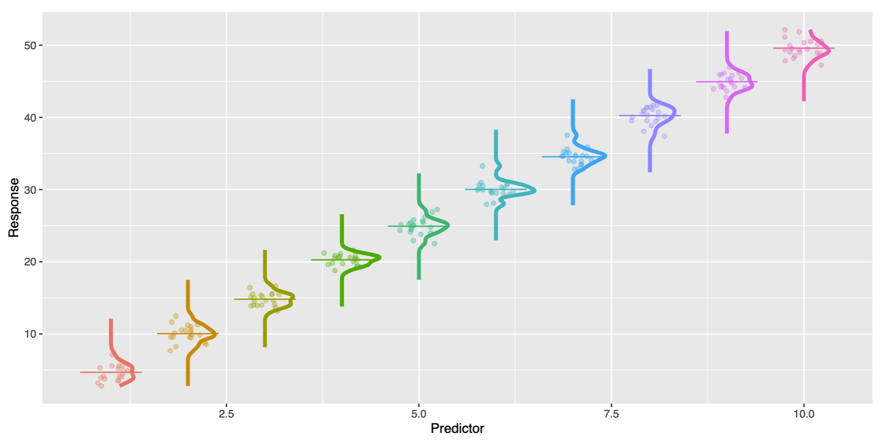{width=95% fig-align="left"}

:::

::: {.column width="50%"}

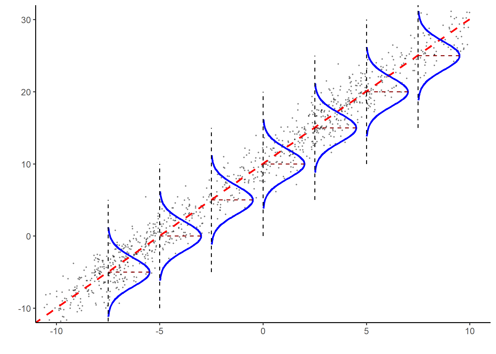{width=95% fig-align="right"}

:::

:::

---

<!-- ### Confidence Intervals for the Mean Response

As mentioned before, we can use the regression model to estimate $E(y_h|\vec{x}_h) = \vec{x}_h\beta$. Much like before, we can calculate the standard error of the expected prediction and use this to generate a $t$-interval.

The general formula is: $\text{sample estimate} \pm (\text{t-multiplier} \times \text{standard error of expected prediction})$

Standard error of the fit: $SE[\bar{y_h}] = \sqrt{se^2(\vec{x}_h^T(X^TX)^{-1}\vec{x}_h)}$
- For Simple Linear Regression, $SE[\bar{y_h}] = se\sqrt{\frac{1}{n}+\frac{(x_h-\bar{x})^2}{\sum_{i=1}^n(x_i-\bar{x})^2}}$

Confidence Interval: $\bar{y_h} \pm t_{\frac{\alpha}{2},n-p-1}\times SE[\bar{y_h}]$

### Confidence Intervals for the Mean Response

<div style="display: flex; align-items: center; gap: 5px;">

  <div class="fragment"; style="flex: 1;">
    <p>Standard error grows for values of $\vec{x}_h$ further away from $\bar{X}$.</p>
    <p>Estimated variance of $y_h$ is at the minimum at the mean of the independent variable</p>
    <p>Predictions near $\bar{x}$ have the narrowest confidence band and the corresponding predictions are the most stable. Confidence bands flare out further away from the mean of the independent variable.</p>
  </div>

  <div class="fragment"; style="flex: 1;">
    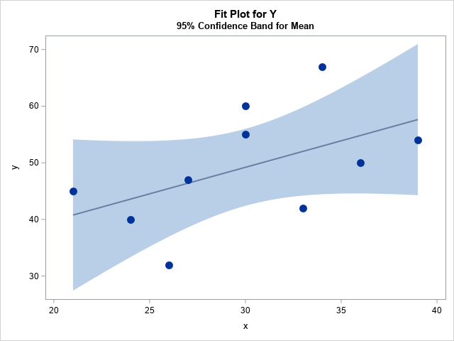
  </div>
</div>

### Prediction Intervals of an Individual Response

Prediction intervals are uncertainty around an individual response value $\hat{y_h}$, for a given observation $\vec{x}_h$, rather than a statistic like the mean response or a model coefficient.
- Gives us the range of likely predicted values for a given observation.

Much like before, the general formula is: $\text{Sample estimate} \pm (\text{t-multiplier} \times \text{standard error})$

Standard error of the prediction: $SE[\hat{y_h}] = \sqrt{se^2(1+\vec{x}_h^T(X^TX)^{-1}\vec{x}_h)}$
- For Simple Linear Regression, $SE[\hat{y_h}] = se\sqrt{1+\frac{1}{n}+\frac{(x_h-\bar{x})^2}{\sum_{i=1}^n(x_i-\bar{x})^2}}$

Confidence Interval: $\hat{y_h} \pm t_{\frac{\alpha}{2},n-p-1}\times SE[\hat{y_h}]$

### Prediction Intervals of an Individual Response

<div style="display: flex; align-items: center; gap: 5px;">

  <div class="fragment"; style="flex: 1;">
    <p>Prediction intervals are typically <u style="color: blue; font-size: 1.0em; font-weight: bold;">wider</u> than confidence intervals. Using a confidence interval for a single predicted value (not a statistic) will underestimate the uncertainty.</p>
    <p>Confidence Intervals aim to capture the variation in mean response due to sampling variability. Prediction Intervals also factor in the random error ($\epsilon$) that can manifest in individual response values due to the inherent variability of individual observations.</p>
  </div>

  <div class="fragment"; style="flex: 1;">
    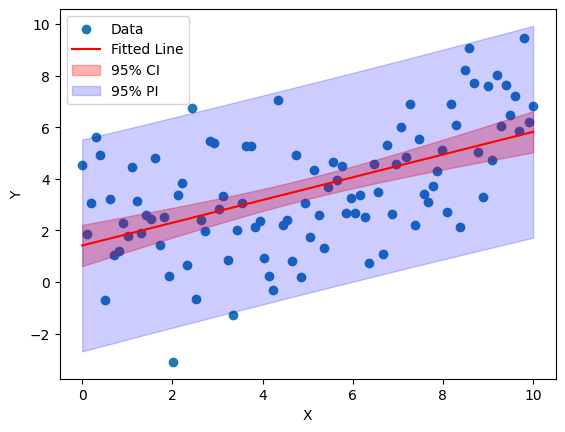
  </div>
</div>

#### Confidence and Prediction Intervals in Practice 

- We do not have to use these formula to calculate the intervals by hand. Instead, we can reliably use statistical packages like `statsmodels`.

- `summary_table` gives a lot of information, pretty much all that could reasonably be of an analyst's interest.

::: {.columns}

::: {.column width="50%" style="font-size:0.56em;"}

#### R

```{r}
# Confidence and prediction intervals for each observed predictor combination
prediction_table <- predict(
  model,
  newdata = bac_data,
  interval = "prediction",
  level = 0.95
)

prediction_table
```

:::

::: {.column width="50%" style="font-size:0.56em;"}

#### Python

```{python}
from statsmodels.stats.outliers_influence import summary_table
st, data, ss2 = summary_table(model, alpha = 0.05)
st
```

:::

:::
-->

### Multicollinearity

The issue of linearly dependent (or “almost” linearly dependent) column/variables is called multicollinearity. Multicollinearity occurs when a variable column in your design matrix is highly or perfectly correlated with a linear combination of one or more columns. So the variable is not capable of adding new information to the model.

<span style="color:#1565C0;"><b>Structural Multicollinearity</b></span>: Creating new predictors from other predictors through mathematical transformations. This is a design issue but does not reflect a problem with the data itself.

- For example, multicollinearity can occur when $p$ dummy variables are incorporated into a model instead of $p-1$ for a categorical variable that has $p$ levels.

<span style="color:#1565C0;"><b>Data-based multicollinearity</b></span>: Result of a poorly designed experiment, reliance on observational data where variables naturally move together. Why can't a researcher just collect his data in such a way to ensure that the predictors aren't highly correlated?

- Unfortunately, researchers often can't control the predictors. For example when gathering a person's gender, race, grade point average, math SAT score, IQ, and starting salary, one or more variables maybe dependent on others but data collectors in such observational studies cannot control for them.

<u style="color: blue; font-size: 1.0em; font-weight: bold;">Big problem</u>: Of the two, data-based multicollinearity is the type that is actually problematic.

---

### Multicollinearity

`statsmodels` should give you a warning when you have issues with multicollinearity. It’s good practice to check your models even if you don’t see this warning!

- <b>First check</b>: Derive a correlation matrix of your predictors. Do not include the response variable as we want our predictors to have high correlation with it.
- <b>Second check</b>: Variance Inflation Factor to systematically remove variables that can be explained by others.
    - $VIF = \frac{1}{(1-R^2_x)}$; where $R^2_x$ is the variation in $x$ that can be explained by its relationship to other variables in the model.
        - Treat x as the response variable that you are trying to predict from the remaining explanatory variables. Calculate $R^2$ of this auxiliary regression. *VIF over 10 is worrisome.*

:::{.callout-note}

## Why do we care?

The main reason to address severe multicollinearity is not that it necessarily makes the regression fit poorly. Rather, it obfuscates the unique contributions of individual predictors within our model. For example if $X_1$ and $X_2$ always move together, holding $X_1$ constant there would be little observations in the dataset where $X_2$ independently changes making its association with the response hard to gauge. This has a few consequences.

- Coefficient estimates are unstable upon minor changes in the sample.
- Coefficient standard errors become larger due to the model's limited certainty around individual coefficients.
- As a consequence, $t$-statistics, $p$-values and confidence intervals also become larger.

:::


---

### Multicollinearity handling

First we start with the full model

::: {.columns}

::: {.column width="35%"}

#### R

```{r}
# Ensure the dummy variable is numeric
bac_data$Gender_OSU_male <- as.integer(bac_data$Gender_OSU_male)

full_model <- lm(
  BAC ~ Beers + Weight_OSU + Gender_OSU_male + Sobr1 + Sobr2,
  data = bac_data
)

summary(full_model)
```

:::

::: {.column width="65%"}

#### Python

```{python}
#convert boolean column to numeric
bac_data['Gender_OSU_male'] = bac_data['Gender_OSU_male'].astype(int)
full_model = smf.ols(
    'BAC ~ Beers + Weight_OSU + Gender_OSU_male + Sobr1 + Sobr2',
    data=bac_data
).fit()
full_model.summary().tables[0]
```

:::

:::

---

### Multicollinearity handling

While the overall model seems statistically significant, some predictors have high $p$ values and relatively higher standard error. Let's investigate further by computing VIF of all predictors

::: {.columns}

::: {.column width="40%"}

#### R

```{r}
summary(full_model)$coefficients
vif_values <- vif(full_model)
vif_table  <- data.frame(Predictor = names(vif_values), VIF = vif_values)
print(vif_table, row.names = FALSE)
```

:::

::: {.column width="60%"}

#### Python

```{python}
full_model.summary().tables[1]

bac_predictors = bac_data[['Beers', 'Weight_OSU', 'Gender_OSU_male', 'Sobr1', 'Sobr2']]
bac_predictors = sm.add_constant(bac_predictors)
vif = pd.DataFrame({
    'Feature': bac_predictors.columns,
    'VIF': [variance_inflation_factor(bac_predictors.values, i) for i in range(len(bac_predictors.columns))]
})
vif
```

:::

:::

---

### Multicollinearity handling

Investigating the VIF table, we see that none of the predictors are severely collinear to each other and their VIFs are all below 10. This is good news and the high $p$ values cannot be attributed to multicollinearity!

However, for datasets where the number of predictors is large, it is possible that some predictors are highly collinear with each other. In such cases, we can use the VIF table to identify and progressively remove the most collinear predictor and refit the model until VIFs are acceptable again.

:::{.callout-note .fragment}

## The impact of sample size

In the BAC example, we have 16 samples and for a model with 6 parameters (*an intercept plus five slopes*) $df_\text{residual} = 16-6= 10$.

So the model might explain BAC very well but with only 16 observations and several predictors, there may not be enough information to estimate every predictor's unique contribution precisely. This could explain the considerable uncertainty around some predictors in our post regression analysis given we are trying to estimate several effects from a very small dataset.

:::

:::{.callout-tip .fragment}

## Other strategies to handle multicollinearity

1. Feature Engineering: Instead of deleting a redundant variable and throwing away data, combine the highly correlated features into a single, comprehensive variable.
2. Regularization: If your primary goal is prediction rather than coefficient explanation. *More on this later*
3. Adding more data can also help. Your current sample could lack rows where your collinear variables move independently of each other due to data deficiency.

:::

---

### Multicollinearity handling

<span style="color:#1565C0;"><b>One caveat</b></span> to consider before removing a predictor with a high VIF score is its **substantive importance** in predicting or explaining the response variable. For example, suppose the VIF table reveals a high score for `Weight_OSU`, while the regression summary indicates that, holding beers consumed, gender, and sobriety scores constant, weight is significantly associated with BAC. This would suggest that `Weight_OSU` shares substantial information with other predictors, but still contributes unique information about BAC.<br>

<span style="color:#1565C0;"><b>Ask yourself</b></span>: does weight provide more meaningful interpretive value than, for example, one of the sobriety-test scores for the research question? If so, **do not blindly remove it!**

Instead, investigate **why the predictors are collinear**. For example, `Weight_OSU` might be associated with gender if male and female participants tend to differ systematically in weight. Depending on the research question, possible responses to problematic multicollinearity include:

- retaining an important predictor despite its high VIF;
- removing one of two predictors that measure largely redundant information;
- combining closely related predictors when scientifically defensible; or
- collecting additional observations that provide more independent variation among the predictors.

:::{.callout-note .fragment}

## Centering or standardization does not generally remove data-based multicollinearity between distinct predictors.

It is more useful to alleviate certain forms of structural multicollinearity, such as that introduced by polynomial or interaction terms, reducing VIF without changing model fit or inference for slopes.

:::

---

### Assumptions of Linear Regression

Some key conditions essential to linear regression:

<ul>
  <li class="fragment"><u style="color: blue; font-size: 1.0em; font-weight: bold;">L</u><b>inearity</b>: We predict the expected response $E(Y)$ for a given observation $X$ and it exhibits a linear relationship with the explanatory variables (predictors) in $X$</li>
  <li class="fragment"><u style="color: blue; font-size: 1.0em; font-weight: bold;">I</u><b>ndependent Residuals</b>: The error terms $\epsilon_i$ for each prediction (also known as the residual) are independent, meaning that the value of the error for one case gives no information about the value of the error for another case.</li>
  <li class="fragment"><u style="color: blue; font-size: 1.0em; font-weight: bold;">N</u><b>ormality of Residuals</b>: The error terms $\epsilon_i$ for each prediction are n.i.d., i.e. normally distributed around the regression hyperplane (line in 2D).</li>
  <li class="fragment"><u style="color: blue; font-size: 1.0em; font-weight: bold;">E</u><b>quality of Variance</b>: The error terms $\epsilon_i$ have the same variance for all observations</li>
</ul>

<span class="fragment">An equivalent way to think of linearity is that the conditional mean of the error, 
$E(\epsilon_i|X_i)=0$
. If the model perfectly captured the average trend, then any deviation (residual) above the line should be cancelled by the ones below it, thereby keeping the average error at 0.</span>

<span class="fragment">All four conditions can be summed up by: 
$$
P(e|X) \sim \mathcal{N(0, \sigma^2 I_n)}
$$
</span>

<span class="fragment">Next we will see how to check if each of these conditions holds.</span>

---

### Linearity

- You can check this assumption using scatterplots – one for each predictor vs the response variable.
- You can also check for linearity with a scatterplot of the (standardized) residuals, against the predicted values (on the horizontal axis).
  - Residuals scattered approximately around 0 across the full range of predicted values, with roughly similar number of positives and negatives.
  - No systematic curve or bend in the residuals.
- What do you do if your data are not linear?
    - Transformations (log, square root, inverse, etc.) on either the predictors or responses.

::: {.columns}

::: {.column width="40%"}

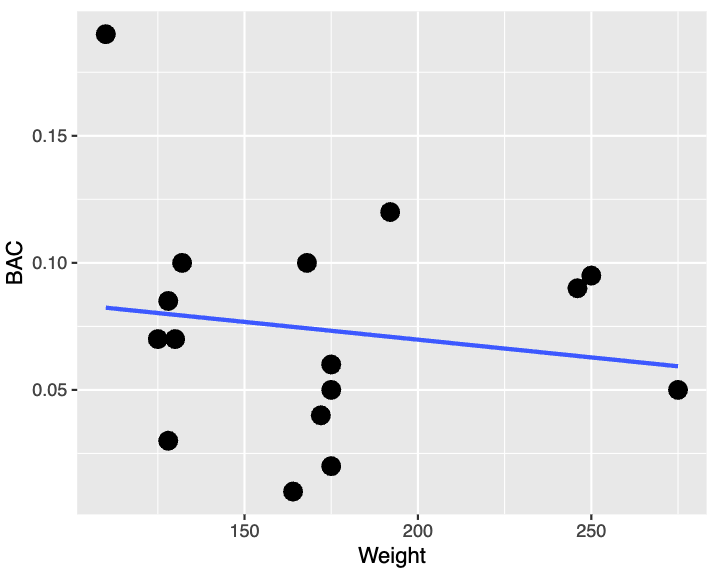{width=100% fig-align="center"}

:::

::: {.column width="60%"}

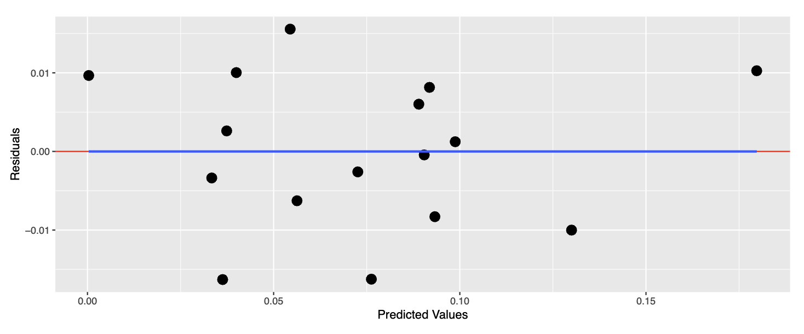{width=92% fig-align="center"}

:::

:::

---

<!-- ### Standardized Residuals

- Residuals can be sensitive to the scale of the data and the presence of outliers. In other words, some points are expected to be closer to the line than others.</br> Standardized residuals adjust for that, so we don’t unfairly judge them.
- We already know that residuals in a true linear relationship are centered around 0. Standardized residuals $e^{std}_i$ are obtained by dividing the raw residuals by the standard deviation of residuals, se.
$
e^{std}_i = \frac{y_i-\hat{y}_i}{se}
$
- $P(e^{std}_i|X) \sim \mathcal{N(0, 1)}$

#### Partial Residuals

<span class="fragment">A scatterplot like <u style="color: blue; font-size: 1.0em; font-weight: bold;">BAC vs Weight</u> shows the marginal relationship between the response variable and the predictor while ignoring all other predictors. But this is not what we estimate in linear regression.
$$\beta_j = \text{effect of } X_j \text{ while holding all other predictors fixed}$$
</span>

<span class="fragment">A predictor can look weak or nonlinear marginally but show strong conditional linearity or vice versa.
</span>

<span class="fragment">A partial residual with respect to the $j$-th predictor is
$$\begin{aligned}
r^{(j)}_i &= y_i - \sum\limits_{k \neq j} \hat{\beta}_kx_{ik} \implies
r^{(j)}_i = \hat{\beta}_jx_{ij} + e_i
\end{aligned}$$
</span>

<span class="fragment">Sometimes this is thought of as an added value–how much else does this particular predictor contribute? Marginal plots cannot show this.
</span> 
-->

### Independence and Uncorrelated Residuals

We assume that the error associated with one observation does not systematically depend on the errors associated with other observations. In particular, we want residuals to be **uncorrelated across observations**.

::: {.fragment}

**When observations have a meaningful order** (e.g., time or spatial order):

- Plot residuals against the **order of observations**.
  - Residuals should fluctuate randomly around zero with **no systematic sequence or clustering**.
  - Long runs of positive or negative residuals, repeating cycles, or neighboring residuals with similar values can indicate autocorrelation. <span style="color:#1565C0;">**Autocorrelation**</span> occurs when residuals are correlated with other residuals according to their ordering.
- The <span style="color:#1565C0;">**Durbin--Watson test**</span> can be used to detect correlation between neighboring residuals when the ordering is meaningful.

**Most commonly violated in:** Time-series data; Spatial data; clustered observations.

:::

::: {.callout-warning .fragment}

## What if the observations have no meaningful order?

If the observations have **no meaningful order or grouping**, plotting residuals against row number or applying a test such as Durbin--Watson is not informative. The result would depend on an arbitrary ordering of the rows.

In this case, independence should be assessed primarily from the **study design and data-collection process**: consider whether observations were independently sampled and whether repeated measurements, clustering, spatial relationships, or other dependencies could connect observations.

:::

---

### Normality of Residuals

For the usual inferential procedures in linear regression, we assume that the **errors around the fitted regression model are approximately normally distributed**:
$$
\epsilon_i= y_i-\hat{y}_i; \epsilon_i \sim N(0,\sigma^2)
$$

::: {.fragment}

::: {.columns}

::: {.column width="50%"}

If residuals are **standardized**, we expect them to approximately follow a **standard normal distribution**.

In practice, we therefore look for a residual distribution that is:

- approximately symmetric and bell-shaped,
- centered around zero, and
- without substantial departures in the tails.

:::

::: {.column width="50%"}

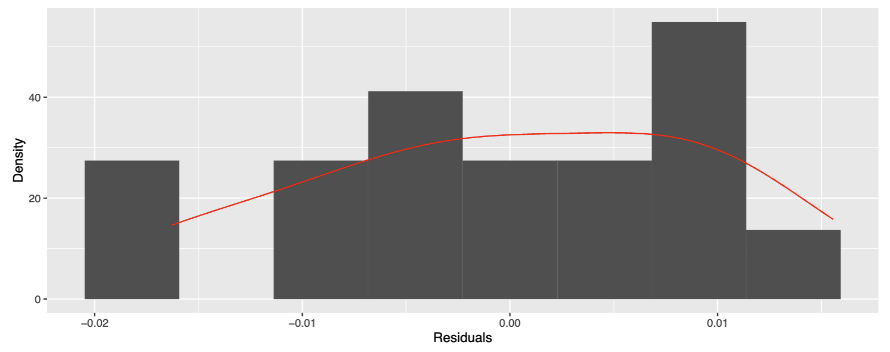{width=90% fig-align="center"}

:::

:::

:::

::: {.fragment}

<span style="color:#1565C0;">**Possible remedies**</span>: Non-linear transformations (log, square root, inverse, etc.) on either the predictors or responses.

:::

---

### Checking Normality of Residuals

We should use **visual diagnostics and a formal test together** when assessing residual normality.

::: {.columns}

::: {.column width="50%"}

#### Visual checks

::: {.fragment}

1. **Histogram of residuals**

- Look for an approximately symmetric, bell-shaped distribution centered near zero.
- Useful for seeing skewness, multiple modes, and unusual observations.

2. **Normal Q--Q plot**

- Compares the observed *standardized* residuals ($Y$-axis) with the quantiles that are expected ($X$-axis) under a normal distribution.
- Residuals that are approximately normal should fall reasonably close to the diagonal reference line.
- Systematic curvatures or $S$-shaped patterns around the line or strong departures in the tails suggest violations of normality.

:::

:::

::: {.column width="50%"}

#### Shapiro--Wilk test

::: {.fragment}

The Shapiro--Wilk test formally evaluates:

$$\begin{aligned}
H_0 &:\text{residuals are consistent with normality}\\
H_A &:\text{residuals depart from normality}
\end{aligned}
$$

- <span style="color:#1565C0;">**Small $p$-value**</span>: evidence against normality.
- <span style="color:#1565C0;">**Large $p$-value**</span>: insufficient evidence to reject normality; it does *not* prove that the residuals are normal.

:::{.callout-note .fragment}

## What to use

Use the test *alongside* the Q-Q plot that is generally more diagnostically useful than expecting a histogram, especially with a small dataset such as the BAC example. With only 16 observations, a histogram can look quite irregular even when the underlying errors are reasonably normal, and the Shapiro–Wilk test also has limited power to detect departures.

:::

:::

:::

:::

---

### What if residual normality is violated?

::: {.columns}

::: {.column width="55%"}

::: {.fragment}

What <span style="color:#1565C0;"><i>does not</i></span> break:

- Least-squares coefficient estimates
- Linearity of the fitted model
- $R^2$
- Point predictions

Violation of residual normality does not, by itself, invalidate the fitted least-squares line or its coefficient estimates. Normality is primarily important for the *sampling distributions used for statistical inference*, especially in smaller samples.

What <span style="color:#1565C0;"><i>does</i></span> break:

- Hypothesis tests for model coefficients
- Confidence intervals for coefficients and mean responses
- Prediction intervals
- Outlier diagnostics (more on this later!)

:::

:::

::: {.column width="45%"}

::: {.fragment}

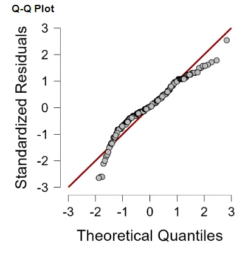{width=90% fig-align="center"}

:::

:::

:::

::: {.fragment}

These inferential procedures make stronger assumptions about normality; consequently, the usual $t$-statistics and related inference may no longer be reliable.

:::

---

### Equality of Variance

We can examine **residuals against the predicted (fitted) values** to assess whether the error variance remains approximately constant across the range of the model's predictions.

::: {.fragment}

What we want is <span style="color:#1565C0;"><b>Homoscedasticity</b></span>: approximately equal variance of the errors across values of the predictors, reflected by a roughly constant spread of residuals around $0$.

- Look for residuals scattered around $0$ with a **roughly constant vertical spread** across whole range of fitted values.
- A spread that systematically **widens or narrows** (e.g., a funnel or fan shape) suggests non-constant variance.

:::

::: {.fragment}

Violation of this condition is called <span style="color:#1565C0;"><b>Heteroscedasticity</b></span>.

- Standard errors may inaccurately describe uncertainty in the coefficient estimates; consequently, hypothesis tests, confidence intervals, and $p$-values can be misleading.
- Consider transformations when the changing variance is related to the scale or distribution of the variables.
- Consider alternative model specifications or methods that account for non-constant variance.

:::

::: {.callout-note .fragment}

The **same Residuals vs. Fitted Values plot** helps assess two different assumptions:

- **Linearity:** look for systematic curvature or other patterns around the *center* of the residual cloud.
- **Homoscedasticity:** look for changes in the *vertical spread* of the residual cloud.

:::

---

### Homoscedasticity
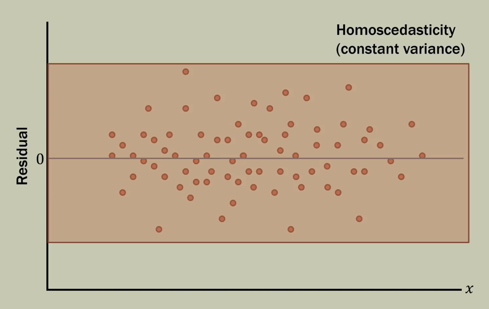

---

### Heteroscedasticity

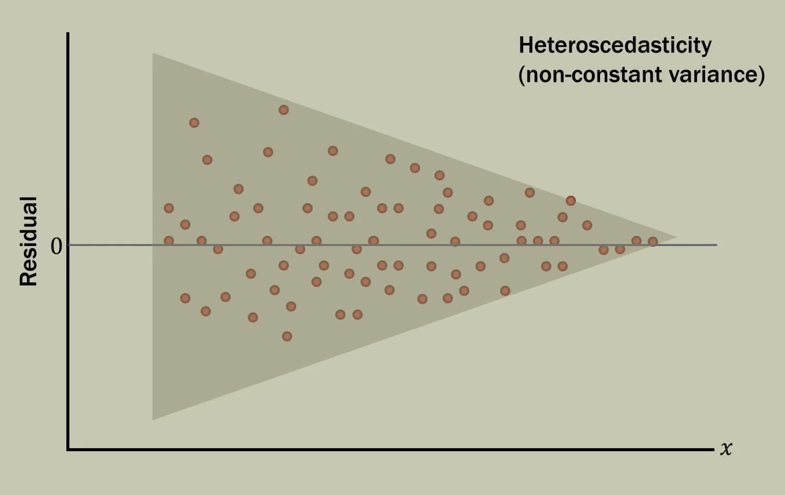

---

### Non Linearity

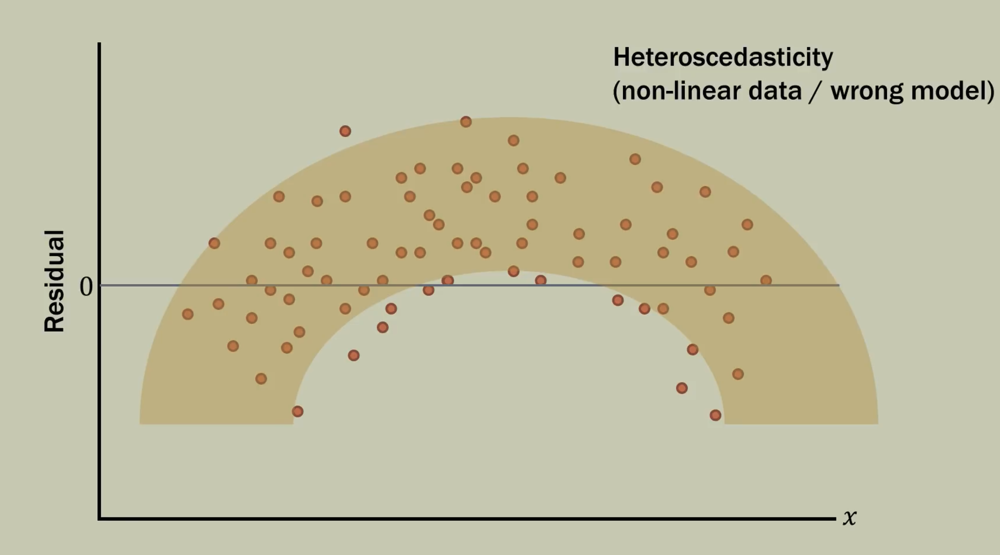

---

### Outliers and Influential Observations

Always do scatter-plots. They are conceptually simple but can reveal the shape and pattern of your data and reveal a lot of information.

::: {.fragment}

<span style="color:#1565C0;"><u><b>Outliers</b></u></span>: Can influence the regression line/hyperplane by pulling it in the direction of the outlier.

- A value that can appear out of the norm or extreme for the response; does not follow the predicted pattern of the model.
- Poorly predicted by the model. A point whose value may fall within the expected range but produces an extremely large residual.

Removing an observation simply because it is an outlier is not a good idea, but it is also not a good idea to report a conclusion that rests on one or two data points.

:::

---

### Outliers and Influential Observations

<span class="fragment">
    <u style="color: blue; font-size: 1.0em; font-weight: bold;">Influential Observation</u>: It could be an outlier, but not necessarily. The point has a disproportionate effect on model estimates and interpretations.
    <ul>
    <li><u><b>High Leverage Point</b></u>: Could be a value corresponding to an observation that is <u>horizontally</u> further away from the rest of the observations in the sample. These points exhibit very strong influence on the least squares plane.<br>Some outliers are high leverage points, but all high leverage points are <b>NOT</b> outliers.</li>
    <li>It could be a value of the dependent variable that is far outside of the rest of the values for the data.</li>
    </ul>
</span>

::: {.callout-note .fragment}

## Outliers vs. Influential Observations

**Outliers** are unusual in the response. **Influential observations** are unusual in how much they affect the fitted model.

Influential observations can substantially change:

- regression coefficients,
- the strength and direction of relationships between predictors and the response,
- model significance, and
- standard errors.

:::

---

### Influential Observations

::: {.columns}

::: {.column width="55%"}

::: {.fragment}

**Influential points** are observations that substantially **influence the slope of the fitted regression line**. They are often (but not always) high-leverage points.

Influence is a combination of **leverage** and how extreme a point is in the $y$-direction.

- Influential points could change a strong relationship to a weak relationship.
- Influential points could change a weak relationship to a strong relationship.

<span style="color:#1565C0;">**High-leverage outlier points can be very influential!**</span>

:::

:::

::: {.column width="45%"}

::: {.fragment}

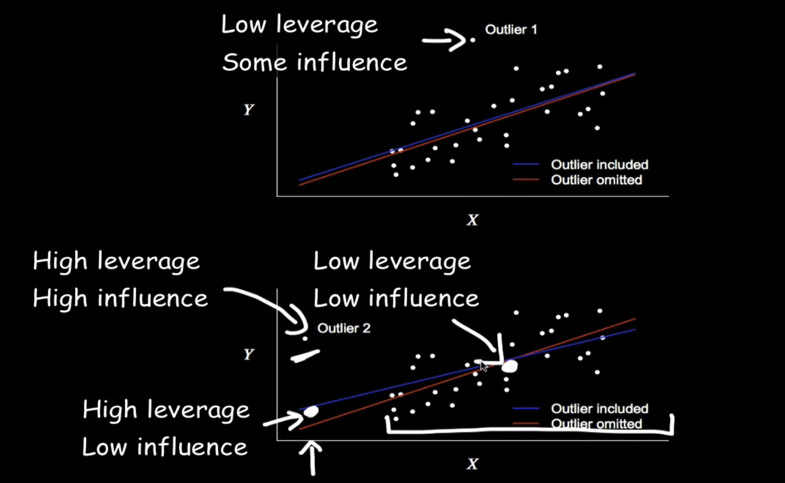{width=90% fig-align="center"}

:::

:::

:::

---

### How to deal with influential observations?

- One way to assess the influence of an observation is to temporarily remove the observation to see whether the answers to the questions of interest change.
    - Does the evidence from a test change from slight to convincing? Does the decision to include a term in the model change?
    - Does an important estimate change by a practically relevant amount?
- If not, the observation is not influential.
- If so, we need to deal with it!
- If an influential observation is not particularly unusual in its explanatory variables, and if no definitive explanation for its unique behavior can be found,
omitting it cannot be justified.
    - More data are needed to answer the questions of interest.
    - As a last resort, report sensitivity: the results with and without the influential observation.

---

### Case-Influence Statistics

Case-influence statistics are numerical measures that reveal insight regarding individual influence of each observation (or “case”) on the overall regression.

- They can help identify influential observations that may not be visible in a graph
- They partition the overall influence of an observation into what is unusual about its explanatory variable values and what is unusual about its response relative to the fitted model.

We will discuss five complementary case-influence statistics:

1. **Leverage** (<span style="color:#1565C0;">***unusualness in predictor space***</span>)
2. **Studentized residuals** (<span style="color:#1565C0;">***unusualness in the response; useful for outlier detection***</span>)
3. **Cook’s distance** (<span style="color:#1565C0;">***overall influence on the fitted model***</span>)
4. **DFFITS** (<span style="color:#1565C0;">***influence on an observation’s fitted value***</span>)
5. **DFBETAS** (<span style="color:#1565C0;">***influence on individual model coefficients***</span>)

---

### Leverage

The leverage of a case is a measure of the distance between its explanatory values and the average of the explanatory variable values in the entire dataset. 

- For simple linear regression with one predictor, leverage is given as the proportion of the total sum of squares in $X$ due to a single case, but it can also be re-expressed as the distance from the center of the dataset in terms of standard deviations.
$$
h_i = \frac{(X_i-\bar{X})^2}{\sum(X_i-\bar{X})^2} + \frac{1}{n}
$$

- For multiple explanatory variables, the calculation is more involved (not included) but the concept is the same: <i>proportion of the total sum of squares due to a single case.</i>

<u style="color: blue; font-size: 1.0em; font-weight: bold;">Rule of thumb</u>: Although model dependent, if $h_i>2\frac{p+1}{n}$ the case should be flagged.

---

### Estimating Leverage in Practice

Let us check the leverage of individual observations on a reduced model to predict BAC that uses 4 predictors. As we will see, there are some high leverage points. 

To estimate leverage, we probe into something called <span style="color:#1565C0;">*the hat matrix*</span>.

::: {.columns}

::: {.column width="50%"}

#### R

```{r}
bac_data$Weight_c <- bac_data$Weight_OSU - mean(bac_data$Weight_OSU)
model2 <- lm(
  BAC ~ Beers + Weight_c + Gender_OSU_male + Sobr2,
  data = bac_data
)
influence_vals <- influence.measures(model2)
leverage <- hatvalues(model2)

print(leverage)
print(sum(leverage))

# Checking individually for high leverage using the same rule of thumb
print(leverage > 2 * 5 / 16)
```

:::

::: {.column width="50%"}

#### Python

```{python}
bac_data['Weight_c'] = bac_data['Weight_OSU'] - bac_data['Weight_OSU'].mean()
model2 = smf.ols(
    'BAC ~ Beers + Weight_c + Gender_OSU_male + Sobr2',
    data=bac_data
).fit()
influence = model2.get_influence()
leverage = influence.hat_matrix_diag
print("Leverage of all 16 points:", leverage)
print(leverage.sum())
#checking individually for high leverage as per rule of thumb
print(leverage>2*5/16)
```

:::

:::

---

### DFFITS: Difference in Fits

**DFFITS** measures how many standard-error units the fitted value of observation $i$ changes when it is removed from the model. Large absolute values indicate observations whose inclusion impart high influence.<br> 
<span style="color:#1565C0;">**Rule of thumb**</span>: $\scriptsize |\text{DFFITS}_i| > 2\sqrt{\frac{p+1}{n}}$; $p$ is the **number of predictors**(*excluding the intercept*).
$$\scriptsize
\text{DFFITS}_i = \frac{\hat y_i-\hat y_{i(-i)}}{\text{se}}
$$

::: {.columns}

::: {.column width="50%"}

#### R

```{r}
dffits_vals <- dffits(model2)

dffits_df <- data.frame(
  DFFITS = dffits_vals
)

# Rule-of-thumb cutoff
n <- nobs(model2)
p <- length(coef(model2))
cutoff <- 2 * sqrt(p / n)

dffits_df$Flag <- abs(dffits_df$DFFITS) > cutoff

dffits_df
```

:::

::: {.column width="50%"}

#### Python

```{python}
influence = model2.get_influence()

dffits_vals, _ = influence.dffits

n = model2.nobs
p = len(model2.params)
cutoff = 2 * np.sqrt(p / n)

dffits_df = pd.DataFrame({
    "DFFITS": dffits_vals,
    "Flag": np.abs(dffits_vals) > cutoff
})

dffits_df
```

:::

:::

---

### DFBETAS: Difference in Betas

**DFBETAS** is a coefficient-centered measure. It scales how much an estimated coefficient $\beta_j$ changes, relative to it's standard error, when observation $i$ is removed . This tells us **which particular coefficient an observation is influencing**. 
For coefficient $j$: $\scriptsize \text{DFBETAS}_{ij} = \frac{\hat\beta_j-\hat\beta_{j(-i)}}{se_{(-i)}(\hat\beta_j)}$. 
<span style="color:#1565C0;">**Rule of thumb**</span>: $\scriptsize |\text{DFBETAS}_{ij}| > \frac{2}{\sqrt{n}}$

::: {.columns}

::: {.column width="50%"}

#### R
```{r}
dfbetas_vals <- dfbetas(model2)

# Flag coefficients exceeding cutoff
n <- nobs(model2)
cutoff <- 2 / sqrt(n)
dfbetas_flags <- abs(dfbetas_vals) > cutoff

# Print as a dataframe
dfbetas_df <- as.data.frame(dfbetas_flags)
dfbetas_df
```

:::

::: {.column width="50%"}

#### Python

```{python}
influence = model2.get_influence()
dfbetas_vals = influence.dfbetas
# Flag coefficients exceeding cutoff
n = model2.nobs
cutoff = 2 / np.sqrt(n)
dfbetas_flags = pd.DataFrame(
    np.abs(dfbetas_vals) > cutoff,
    columns=model2.model.exog_names
)
dfbetas_flags
```

:::

:::

:::{.callout-note}

## What does `model.exog_names` mean?

In `statsmodels`, **exog** refers to the **exogenous variables** used to construct the regression design matrix $X$. This by default includes the intercept alongside the predictors in our data. 
Also, if a categorical predictor with four levels is represented by three separate columns in \(X\), we will find three coefficient names (one for each new column) in `exog_names`.

:::


---

### Cook’s distance

**Cook's distance** measures the effect that omitting a case has on the estimated regression coefficients. Joint effect of leverage and residual. 
$$\scriptsize D_i = \sum\limits_{j=1}^{n}\frac{(\hat{y_j}-\hat{y_{j(-i)}})^2}{(p+1)\times se^2}$$
where $\hat{y_j}$ is the $j$-th fitted value in a fit using all points, $\hat{y_{j(-i)}}$ is the $j$-th fitted value in a fit that excludes the $i$th point in the dataset, $p$ is the number of predictors, and $se^2$ is our estimated variance from the fit based on all observations (the square of our residual standard error as seen many times before).

A case that is influential in changing the least squares estimates when deleted will have a high Cook's Distance.

<u style="color: blue; font-size: 1.0em; font-weight: bold;">Rule of thumb</u>: $\approx \frac{4}{n}$ or above indicate large influence.

::: {.columns}

::: {.column width="50%"}

#### R

```{r}
# Get Cook's distance
cooks_d <- cooks.distance(model2)
print(cooks_d)
```

:::

::: {.column width="50%"}

#### Python
```{python}
# Get Cook's distance
sm_fr = influence.summary_frame()
print("Summary Frame with Cook's Distance:\n", sm_fr['cooks_d'])
```

:::

:::

---

### Leverage vs Cook's Distance

It is difficult, though not mathematically impossible, for a genuinely low-leverage observation to have a very large Cook's distance.

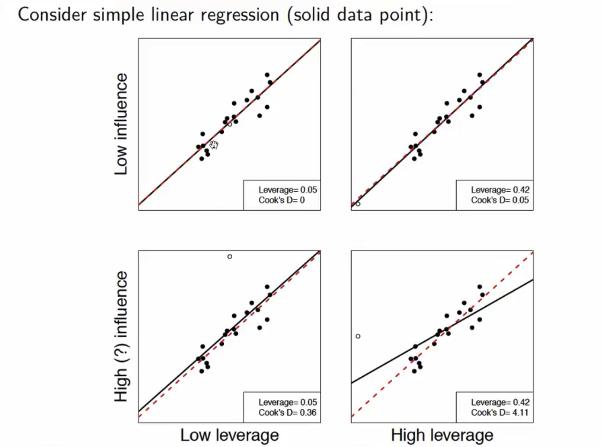

---

### Studentized Residuals: Detecting Outliers

A raw residual tells us how far an observed response is from its predicted value: $e_i = y_i-\hat{y}_i$. But simply asking whether $e_i$ is "large" can be misleading. *Same residual can be more unusual for some observations than for others*.

::: {.fragment}

In particular, observations with high leverage have smaller residual variance because the fitted regression is pulled more strongly toward them. If you look *only* at raw residuals, a massive outlier sitting at a high-leverage position might show a tiny raw error, causing you to completely miss it during your diagnostic screening.

:::

::: {.fragment}

We **studentize residuals** to transform our model's errors into a standardized scale with a constant variance, making it possible to ask:

> **How unusually far is this observation from its fitted value, relative to how much its residual would normally be expected to vary (*in standard deviation units*)?**
$$
\text{Studentized Residual} = \frac{\text{How far the observation is from its fitted value } (e_i)}{\text{How much that residual is normally expected to vary } (se \sqrt{1 - h_i})}
$$

Observations with large absolute studentized residuals are candidates for **outliers in the response direction**.

:::

::: {.callout-note .fragment}

## Outlier $\neq$ influential observation

A large studentized residual does not necessarily mean that the observation substantially changes the fitted model.

- **Studentized residuals:** useful for detecting **outliers**
- **Leverage:** identifies unusual locations in **predictor space**
- **Cook's distance / DFFITS / DFBETAS:** assess **influence on the fitted model**

:::

---

### Studentized residuals

<b><u style="color: blue;">Studentized Residual</u></b>: This ensures that our residuals approximately follow a standard normal distribution. 95\% of the residuals must fall between -2 and 2 and those beyond that can be considered unusual.

- Internally studentized residual: $\frac{e_i}{se\sqrt{1-h_i}}$; $h_i$ is the leverage of the corresponding observation
- Externally studentized residual: $\frac{e_i}{se_{(-i)}\sqrt{1-h_i}}$; $se_{(-i)}$ is the estimated residual standard error <span style="color:#1565C0;"><u>after removing</u></span> observation $i$. <span style="color:#1565C0;">*Gold Standard*</span>

::: {.columns}

::: {.column width="50%"}

#### R

```{r}
studres <- rstudent(model2)
studres
```

:::

::: {.column width="50%"}

#### Python

```{python}
studres = influence.get_resid_studentized_external()
studres
```

:::

:::

---

### Thats all folks!

{width=40% fig-align="center"}


