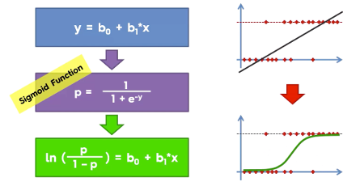
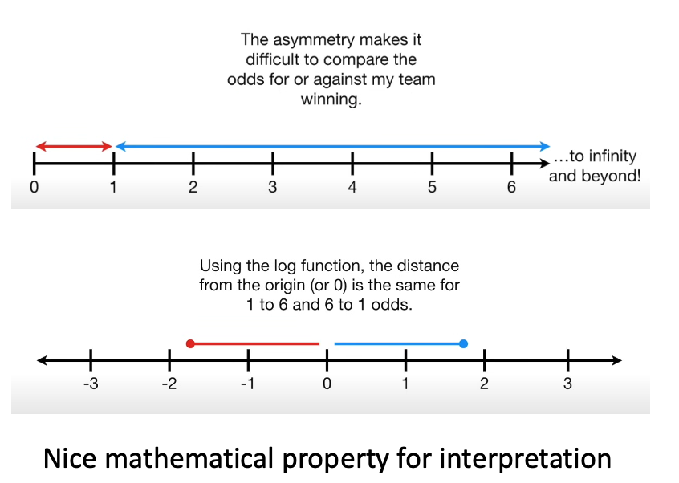

<style>
.reveal blockquote {
  margin-top: 0.2em;
  margin-bottom: 0.2em;
  padding-top: 0.1em;
  padding-bottom: 0.1em;
}
.reveal .slides section {
  font-size: 0.56em;
}
.reveal pre code {
  font-size: 0.85em;
}
.reveal .cell-output {
  font-size: 0.85em;
}
.small { font-size: 0.78em; }
.tiny { font-size: 0.66em; }
</style>

::: {style="height: 80vh; display: flex; align-items: center;"}

::: {.columns .v-center}

::: {.column width="58%"}

### **Moving beyond Linear Regression...**

#### Modeling binary outcomes with Logistic Regression

#### *[Dr. Satadisha Saha Bhowmick]{style="color: blue;"}*

:::

::: {.column width="42%"}

{width=70% fig-align="center"}

::: {style="font-size:0.5em; text-align:center;"}
Woman teaching geometry, from a fourteenth-century edition of Euclid’s geometry book.
:::

:::

:::

:::

---

```{r}
#| label: setup-r
#| include: false

options(warn = -1)

admit_data <- data.frame(
  hours = c(8,10,6,4,3,7,1,10,5,8,5,1,10,6,6,2,8,11,9,3,10,4,7,1,8,3,8,4,3,5,9,5,3,3,7,10,10,3,1,11,9,10,4,9,5,3,6,6,2,6),
  injury_risk_factor = c(86,91,59,90,80,89,59,65,59,76,70,90,86,60,60,55,80,93,63,83,79,67,60,68,58,80,87,87,89,93,74,73,61,60,65,71,55,69,84,72,92,76,90,59,83,94,55,72,88,55),
  admitted = c(1,1,0,0,0,0,0,1,0,1,0,0,1,0,0,0,0,1,0,0,1,0,0,0,1,1,1,0,1,0,1,0,0,0,1,1,1,0,0,0,1,1,1,0,1,1,0,0,0,0)
)
```

```{python}
#| label: setup-python
#| include: false

import numpy as np
import pandas as pd
import matplotlib.pyplot as plt
import statsmodels.api as sm
import statsmodels.formula.api as smf

admit_data = pd.DataFrame({
    "hours": [8,10,6,4,3,7,1,10,5,8,5,1,10,6,6,2,8,11,9,3,10,4,7,1,8,3,8,4,3,5,9,5,3,3,7,10,10,3,1,11,9,10,4,9,5,3,6,6,2,6],
    "injury_risk_factor": [86,91,59,90,80,89,59,65,59,76,70,90,86,60,60,55,80,93,63,83,79,67,60,68,58,80,87,87,89,93,74,73,61,60,65,71,55,69,84,72,92,76,90,59,83,94,55,72,88,55],
    "admitted": [1,1,0,0,0,0,0,1,0,1,0,0,1,0,0,0,0,1,0,0,1,0,0,0,1,1,1,0,1,0,1,0,0,0,1,1,1,0,0,0,1,1,1,0,1,1,0,0,0,0]
})
```

### Learning Outcomes

By the end of this lecture, you should be able to:

<div style="display: flex; gap: 2px;">

<div style="flex: 1;">
<ul>
<li class="fragment">Explain why ordinary linear regression is inappropriate for a binary response.</li>
<li class="fragment">Describe logistic regression as a Generalized Linear Model (GLM).</li>
<li class="fragment">Move between probability, odds, log-odds, and the logistic (sigmoid) function.</li>
</ul>
</div>

<div style="flex: 1;">
<ul>
<li class="fragment">Explain why logistic regression coefficients are estimated using maximum likelihood.</li>
<li class="fragment">Fit and interpret logistic regression models in R and Python.</li>
<li class="fragment">Recognize the main assumptions and common failure modes of logistic regression.</li>
</ul>
</div>

</div>

:::{.callout-caution}

## TIPS WHEN READING THESE LECTURE NOTES

These notes use mathematical notation to make the connections among linear regression, GLMs, and logistic regression explicit.

- Focus on the **conceptual links** between the ideas.
- You do **not** need to memorize every formula. In practice, software estimates the model parameters numerically.
- Keep track of the scale on which we are working: **probability**, **odds**, or **log-odds**.
:::

---

### Where Are We Coming From?

So far, regression has modeled a quantitative response using a linear combination of predictors:
$$
E(Y\mid X)=\beta_0+\beta_1X_1+\cdots+\beta_pX_p.
$$

This framework is powerful because it lets us:

- combine several predictors;
- interpret coefficients conditionally, holding other predictors fixed;
- quantify uncertainty and assess model fit;
- make predictions for new observations.

<span style="color:#1565C0;">But what changes when the response is **binary**?</span>

---

### A Binary Response Changes the Problem

Suppose

$$
Y\in\{0,1\}.
$$

Examples include:

- admitted / not admitted;
- churn / no churn;
- default / no default;
- disease present / absent.

For a given predictor vector $X$, the quantity we want to model is

$$
\pi(X)=P(Y=1\mid X).
$$

Because $Y$ is binary,

$$
E(Y\mid X)=P(Y=1\mid X)=\pi(X).
$$

---

### Why Not Just Use Linear Regression?

A tempting model is the **linear probability model**:

$$
P(Y=1\mid X)=\beta_0+\beta_1X_1+\cdots+\beta_pX_p.
$$

But it creates several problems:

1. Predictions are not restricted to $[0,1]$.
2. A binary response is not normally distributed.
3. The conditional variance is not constant.
4. The relationship between predictors and probability is often not well represented by a straight line.

We need to keep the useful **linear predictor** while changing how it connects to the response.

---

### Bernoulli Trials for Binary Outcomes

For problems with binary outcomes that can represent success/failure, we can model each independent observation as a **Bernoulli trial**. In other words, a binary target variable $Y_i$ follows a **Bernoulli distribution**.

$$
\boxed{Y_i\mid X_i \sim \text{Bernoulli}(\pi_i)},
$$
where,
$$
\pi_i=\mathbb{P}(Y_i=1\mid X_i).
$$

A single trial that follows a Bernoulli distribution has

$$
E(Y_i\mid X_i)=\pi_i,
\qquad
Var(Y_i\mid X_i)=\pi_i(1-\pi_i).
$$

:::{.callout-note}
Unlike OLS, the variance is **not constant**. It changes with the conditional mean $\pi_i$.
:::

---

### We Need a Broader Regression Framework

:::{.callout-tip}

### A unified framework for regression

We need a **unified, consistent framework** that can: 

> model specific assumptions of linearity for diverse data types  

The usual linear regression model is too restrictive.

:::

We would *still* like to keep the familiar <span style="color:#1565C0;">linear combination of explanatory variables</span>,

$$
\eta_i=\beta_0+\beta_1x_{i1}+\cdots+\beta_px_{ip},
$$

while allowing the **distribution of the response** and the **relationship between its expected value and the predictors** to change according to the problem.

Enter <span style="color:#1565C0;">**Generalized Linear Models (GLMs)**</span>!

:::{.callout-tip}

### What can GLMs do for us?

They provide a common language for ordinary linear regression, logistic regression, and other regression models for outcomes such as counts.
:::

---

### Generalized Linear Models

A **generalized linear model (GLM)** is a model in which:

- a response variable is drawn from a specified probability distribution
- its <span style="color:#1565C0;">**expected value**</span> $\mathbb E(Y\mid X)$ is related to the explanatory variables through a <span style="color:#1565C0;">regression equation</span>.

There are <span style="color:#1565C0;">**$3$ components**</span> to a GLM:

1. <span style="color:#1565C0;">**Random component**</span>: specifies the probability distribution of the response variable.

2. <span style="color:#1565C0;">**Systematic component**</span>: specifies the explanatory variables $(X_1,X_2,\ldots,X_k)$ and their linear combination:
   $$\eta=\beta_0+\beta_1X_1+\cdots+\beta_kX_k.$$

3. <span style="color:#1565C0;">**Link function**</span>: specifies relationship between the expected value of the response and the systematic component: $g\!\left(\mathbb E(Y\mid X)\right)=\eta$ *or* $\mathbb E(Y\mid X) = g^{-1}\left(\eta\right)$

:::{.callout-note}

### Things to note about a GLM

- The choice of the response distribution and link function changes with the kind of outcome we wish to model.
- A GLM does **not** require the response itself to be linearly related to the predictors.
- Rather, the *transformed expected response* is linear in the coefficients.
  $$
  \boxed{g\!\left(\mathbb E(Y\mid X_1,\ldots,X_k)\right)
  =\eta=\beta_0+\beta_1X_1+\cdots+\beta_kX_k.}
  $$

:::

---

### OLS Regression Is a Special Case of a GLM

- **Random component:** a continuous response $Y$ with a Normal distribution, conditional mean $\mu=E(Y\mid X)$, and constant variance $\sigma^2$.
- **Systematic component:** a linear combination of continuous or discrete explanatory variables $$\eta=\beta_0+\beta_1X_1+\cdots+\beta_kX_k$$
- **Link function:** <span style="color:#1565C0;">the identity function</span>. $g(\mu)=\mu$, so $\eta=\mathbb E(Y\mid X)$.

In OLS, we typically assume errors are independent of $X$ and have constant conditional variance. In a GLM, the conditional variance may instead be *variable*, depend on the conditional mean.

The *generalization* retains the familiar linear combination of predictors while allowing for other distributions and link functions.

---

### Logistic Regression: The Three GLM Components

For a binary response $Y_i\in\{0,1\}$, the conditional mean is the probability of the positive outcome:

$$\mathbb E(Y_i\mid X_i)=P(Y_i=1\mid X_i)=\pi_i.$$

To round up the GLM specifications of logistic regression:

- **Random component:** $Y_i\mid X_i\sim\operatorname{Bernoulli}(\pi_i)$, equivalently a binomial variable with one trial and success probability $\pi_i$.
- **Systematic component:** $\eta_i=\beta_0+\beta_1x_{i1}+\cdots+\beta_kx_{ik}$.
- **Link function:** the log-odds or <span style="color:#1565C0;">**logit**</span> function,

  $$g(\pi_i)=\log\left(\frac{\pi_i}{1-\pi_i}\right)=\eta_i.$$

This completes the GLM specification.

---

### Why a Link Function?

::: {.columns}

::: {.column width="45%"}

The linear predictor $\eta=X\beta$ can take any value from $-\infty$ to $+\infty$.

But a probability must satisfy

$$
0\leq \pi\leq 1.
$$

We therefore need:

- a transformation that maps probabilities to the entire real line 
- and an inverse transformation that maps the real line back into $[0,1]$

The standard choice for binary logistic regression is the <span style="color:#1565C0;">**logit**</span>.

Inverse of logit is the <span style="color:#1565C0;">**Sigmoid**</span> function.

:::

::: {.column width="55%"}

{width="100%"}

:::

:::

---

### From Probability to Odds

To find the odds of an event, you can use counts of events. You can also divide the proportion of the events that did happen by the proportion of events that did not happen. Odds compare:

> How likely is the event to occur relative to not occurring?

If an event has probability $\pi$, its **odds** are
$$
\boxed{\text{odds}=\omega =\frac{\pi}{1-\pi}.}
$$
Conversely, $\pi=\frac{\text{odds}}{1+\text{odds}}$.

:::{.callout-tip}

### Example
For example, $72.4\%$ of people who regularly take Vitamin C still get colds. Hence the probability of getting a cold is $\pi=0.724$. The odds of getting a cold are $\frac{0.724}{1-0.724}\approx 2.62.$.

This is often expressed as "the odds of getting a cold are 2.62 to 1." *Another way to interpret this is that for every one person that does not develop a cold, 2.62 people do develop colds*, meaning the event is **$2.62$ times as likely to occur as not occur**.
:::

<span style="color:#1565C0;">**Odds range from $0$ to $\infty$** $\rightarrow$ *removes the upper bound from the probability scale*</span>

---

### From Odds to Log-Odds

Odds are positive but asymmetrical around the neutral value $1$. 

> Odds against an event that is ***highly likely*** can vary in the range $0-1$ but odds in favor can go from $1-\infty$.

::: {.columns}

::: {.column width="45%"}

Taking the natural logarithm gives the **log-odds**, or **logit**:

$$
\boxed{\operatorname{logit}(\pi)=\log\left(\frac{\pi}{1-\pi}\right).}
$$

Now the scale runs from $-\infty$ to $+\infty$:

- $\pi<0.5 \Rightarrow \operatorname{logit}(\pi)<0$
- $\pi=0.5 \Rightarrow \operatorname{logit}(\pi)=0$
- $\pi>0.5 \Rightarrow \operatorname{logit}(\pi)>0$

This is exactly the scale on which we place the linear predictor.

:::

::: {.column width="55%"}

{width="100%"}

<span style="color:#1565C0;">*Log odds of failure is the **exact negative** of log odds of success.*</span>

:::

:::

---

### Logistic Regression Model

Logistic regression assumes

$$
\boxed{
\log\left(\frac{\pi_i}{1-\pi_i}\right)
=
\beta_0+\beta_1x_{i1}+\cdots+\beta_px_{ip}
}
$$

or more compactly,

$$
\operatorname{logit}(\pi_i)=\eta_i=X_i\beta.
$$

:::{.callout-note}

### Interpreting a Coefficient: Log-Odds Scale

Logistic regression is **linear in the coefficients on the log-odds scale**. 
$$
\operatorname{logit}(\pi)=\beta_0+\beta_1X_1+\cdots+\beta_pX_p,
$$

> $\beta_j$ is the expected change in **log-odds** associated with a one-unit increase in $X_j$, holding the other predictors fixed.

This interpretation is mathematically clean, but log-odds are not especially intuitive. So we exponentiate the coefficient and that gives us the **odds ratio**. 

:::

---

### The Inverse Link: Logistic / Sigmoid Function

Solving the logit equation for $\pi$ gives

$$
\boxed{
\pi_i
=
\frac{e^{\eta_i}}{1+e^{\eta_i}}
=
\frac{1}{1+e^{-\eta_i}}
}
$$

where

$$
\eta_i=\beta_0+\beta_1x_{i1}+\cdots+\beta_px_{ip}.
$$

The logistic function maps every real-valued $\eta$ to a valid probability between $0$ and $1$.

---

### Seeing the Sigmoid

::: {.columns}

::: {.column width="50%"}

#### R

```{r}
eta <- seq(-6, 6, length.out = 200)
prob <- 1 / (1 + exp(-eta))

plot(eta, prob, type = "l", lwd = 2,
     xlab = "Systematic Component (eta)",
     ylab = "P(Y = 1 | X)")
abline(h = 0.5, lty = 2)
abline(v = 0, lty = 2)
```

:::

::: {.column width="50%"}

#### Python

```{python}
eta = np.linspace(-6, 6, 200)
prob = 1 / (1 + np.exp(-eta))

plt.plot(eta, prob)
plt.axhline(0.5, linestyle="--")
plt.axvline(0, linestyle="--")
plt.xlabel("Systematic Component (eta)")
plt.ylabel("P(Y = 1 | X)")
plt.show()
```

:::

:::

---

### Exponentiating Logistic Regression Coefficients

Recall that the logit is the **log odds function**. Exponentiating the logit yields the odds:
$$
\omega = \frac{\pi}{1-\pi}
= e^{\beta_0+\beta_1X_1+\cdots+\beta_pX_p}
$$

It is also helpful to think about the coefficients in terms of changes in the explanatory variables.

Consider a logistic regression model with one predictor $X$:
$$
\omega_X=e^{\beta_0+\beta_1X}
$$

For a one-unit increase in $X$, the ratio of the odds becomes

$$
\frac{\omega_\text{after}}{\omega_\text{before}}
=\frac{\omega_{X+1}}{\omega_X}
=\frac{e^{\beta_0+\beta_1(X+1)}}{e^{\beta_0+\beta_1X}}
=\boxed{e^{\beta_1}}
$$

Thus, <span style="color:blue;">if $X$ increases by one unit, the odds that $Y=1$ will change by a factor of $e^{\beta_1}$.</span>

---

### Odds Ratios

To compare proportions, we use **differences**. To compare odds, we use **ratios**. The **odds ratio (OR)** compares the odds of an event occurring at two different values of an explanatory variable:
$$\scriptsize
OR=\frac{\text{Odds at }X=A}{\text{Odds at }X=B}
=\frac{\omega_A}{\omega_B}
$$

For a one-unit increase in $X$, the odds ratio is $e^{\beta_1}$.

- $OR>1$: The odds of the event **increase** as $X$ increases.
- $OR=1$: The odds remain unchanged.
- $OR<1$: The odds of the event **decrease** as $X$ increases.

For example, an odds ratio of $1.25$ means that the odds of the event occurring are **1.25 times as large** (25% higher) for a one-unit increase in $X$.<br> 
An odds ratio of $0.80$ means that the odds are **0.80 times as large** (20% lower).


::: {.callout-note}

An odds ratio describes a multiplicative change in **odds**, not a fixed change in probability. The same odds ratio produces different changes in probability depending on the initial probability of the event. For example, an odds ratio of 2 doubles the odds of an event:

- An initial probability of $\pi=10\%$ gives odds of $\omega = 0.10/0.90=0.111$. Doubling these odds gives $\omega' = 0.222$, corresponding to a new probability of $\pi' = \frac{\omega'}{1+\omega'}=\frac{0.222}{1+0.222}=18.2\%$.
- An initial probability of $\pi=50\%$ gives odds of $\omega = 0.50/0.50=1$. Doubling these odds gives $\omega' = 2$, corresponding to a new probability of $\pi' = \frac{\omega'}{1+\omega'}=\frac{2}{1+2}=66.7\%$.

:::


---

### How Do We Estimate the Coefficients?

We now know the form of the model: the explanatory variables combine linearly on the log-odds scale, and the inverse-logit function gives a predicted probability for each observation. 

But **how should we choose the coefficients** $\beta_0,\beta_1,\ldots,\beta_p$?

In ordinary least squares, we found coefficients that minimized the sum of squared residuals. 

For a Bernoulli response, that criterion is not derived from the response distribution we have chosen. Instead, we ask a more general question:

> **Which model makes the data we actually observed most plausible?**

This is the idea behind **maximum likelihood estimation (MLE)**. 

:::{.callout-tip}

### Maximum Likelihood Estimation

It is a general procedure for obtaining estimates of model parameters, not specific to a logistic regression model. We specify the probability model for the data and search for the parameter values that maximize the likelihood of what was observed.
:::

---

### Probability vs Likelihood : Opposite Perspectives

$\color{blue}{\textbf{Which model makes the data we actually observed most plausible?}}$ 

This is the question addressed by maximum likelihood estimation.

- **Probability** asks: *How likely is an outcome given fixed model parameters?* We write $P(\text{data}\mid\theta)$.
- **Likelihood** asks: *Which parameter values make the observed data most plausible?* The data are held fixed, and we vary $\theta$.

The same expression is now viewed as a function of the unknown parameters. Perspective is reversed despite mathematical equivalence (*or proportionality*):

$$\boxed{L(\theta\mid \text{observed data})\equiv P(\text{observed data}\mid\theta).}$$

:::{.callout-tip}

## What changes?

The relationship between your data and your parameters ($\theta$) is captured by the exact same mathematical function, but its <span style="color:blue;">*meaning*</span> changes depending on what we vary -- the data, or the parameters.

$P(data \mid \theta)$ is a valid probability distribution over the data. It integrates to $1$ because for a fixed parameter set, the probabilities of all possible data outcomes must total $100\%$. Likelihood is <span style="color:blue;">*not*</span> a probability distribution over the parameters. If you fix your data and add up the likelihood of all possible $\theta$ they will not add up to 1.

Individual likelihood is <span style="color:blue;">*not*</span> the probability that a parameter is true. It is a way to compare how well candidate parameter values account for the observed data under the assumed model. $L(\theta =0.5 \mid \text{data}) = 0.12$ <span style="color:blue;">*does not mean*</span> that there is a $12\%$ chance that $\theta =0.5$. Instead, it means that the probability of <span style="color:blue;">*generating*</span> your specific dataset given $\theta =0.5$ is $12\%$.

:::

---

### Coin Flip Example: Estimating a Probability

Suppose we observe **7 heads and 3 tails** from 10 independent coin flips. This system has a single parameter, $p$, which denotes the probability of head from a single flip.<br> 
The likelihood of this observed outcome is
$$L(p \mid \text{data})= \binom{10}{7}p^7(1-p)^3$$

Here the data (<span style="color:#1565C0;">7 heads, 3 tails in some random order</span>) are fixed, and $p$ is the <span style="color:#1565C0;">**parameter**</span> we vary to find where the likelihood is maximized. The right-hand side in this case comes from the *binomial distribution* and would remain unchanged even if we were interested in the conditional probability of the data given the parameter.<br> 
<span style="color:blue;">Remember</span> that likelihood and conditional probability have the same mathematical form, but the perspective is reversed.

It turns out that the maximum likelihood estimate for $p$ in this case is simply the proportion of heads observed:
$$\boxed{\hat p=\frac{7}{10}=0.7}$$

:::{.callout-note}

## A note on the parameter $p$

- The parameter $p$ is a fixed but unknown quantity. Even though it individually represents a probability, it is not a random variable, and it does not have a probability distribution. (<span style="color:#1565C0;">*Well actually, in some statistical frameworks it is, but we will not get into those weird, albeit important, philosophical debates here.*</span>)
- In logistic regression, we use the same principle, but each observation has a probability $\pi_i$ determined by its predictors and the regression coefficients.
:::

---

### Connection Back to OLS

When linear regression errors are normal:

$$
Y_i=X_i\beta+\epsilon_i,
\qquad
\epsilon_i\sim N(0,\sigma^2).
$$

Under this model, maximizing the likelihood with respect to $\beta$ is equivalent to minimizing the residual sum of squares.

:::{.callout-note}

## OLS is not disconnected from MLE:

$$
\boxed{\text{OLS is the MLE for }\beta\text{ under the usual Normal-error model.}}
$$

MLE therefore gives us a bridge from linear regression to other response distributions.
:::

---

### Likelihood for Logistic Regression

For observation $i$, the Bernoulli distribution tells us:
$$
P(Y_i=y_i\mid X_i)
=
\pi_i^{y_i}(1-\pi_i)^{1-y_i}; \text{ where } y_i\in\{0,1\}
$$
<span style="color:blue;">Remember</span> that $\pi_i$ is the probability of success for observation $i$, which depends on its predictors and the regression coefficients.
$$
\pi_i=\frac{1}{1+e^{-X_i\beta}}
$$

Assuming independent observations, the likelihood is
$$
\boxed{
L(\beta)
=
\prod_{i=1}^{n}
\pi_i^{y_i}(1-\pi_i)^{1-y_i}
}
$$

:::{.callout-note}

## A note on the notation

$\prod_{i=1}^{n}$ means "multiply together the terms for observations $i=1,2,\ldots,n$." It is the product analog of $\sum_{i=1}^{n}$, which means "add together the terms for $i=1,2,\ldots,n$."

:::

---

### Log-Likelihood and Negative Log-Likelihood

Products of many probabilities can become numerically tiny, so software works with the **log-likelihood**:

$$
\ell(\beta)
=
\sum_{i=1}^{n}
\left[
 y_i\log(\pi_i)+(1-y_i)\log(1-\pi_i)
\right].
$$

Maximizing $\ell(\beta)$ is equivalent to minimizing the **negative log-likelihood**: $-\ell(\beta).$

:::{.callout-note}

## How to solve for $\hat\beta$?

Unlike the OLS case, there is generally no simple closed-form solution for $\hat\beta$ here. So most softwares use numerical optimization like Gradient Descent or Newton-Raphson (You will learn more about these methods in a future course 🫠).

:::

---

### Our Example Data

We will model a binary outcome, `admitted`, using:

- `hours`: hours spent preparing;
- `injury_risk_factor`: an injury assessment score.

This is a small teaching dataset created to illustrate the mechanics of fitting and interpreting a logistic regression model.

::: {.columns}

::: {.column width="50%"}

#### R

```{r}
head(admit_data, 6)
table(admit_data$admitted)
```

:::

::: {.column width="50%"}

#### Python

```{python}
print(admit_data.head(6))
print(admit_data["admitted"].value_counts().sort_index())
```

:::

:::

---

### Visualizing a Binary Outcome

::: {.columns}

::: {.column width="50%"}

#### R

```{r}
plot(admit_data$hours, admit_data$admitted,
     pch = 19,
     xlab = "Hours",
     ylab = "Admitted (0/1)",
     ylim = c(-0.05, 1.05))
```

:::

::: {.column width="50%"}

#### Python

```{python}
plt.scatter(admit_data["hours"], admit_data["admitted"])
plt.xlabel("Hours")
plt.ylabel("Admitted (0/1)")
plt.ylim(-0.05, 1.05)
plt.show()
```

:::

:::

A straight line is not naturally constrained to produce valid probabilities.

---

### Fitting a Logistic Regression Model

We fit

$$
\operatorname{logit}\{P(Y=1\mid X)\}
=
\beta_0+\beta_1(\text{hours})+\beta_2(\text{injury\_risk\_factor}).
$$

::: {.columns}

::: {.column width="50%"}

#### R

```{r}
logit_r <- glm(
  admitted ~ hours + injury_risk_factor,
  data = admit_data,
  family = binomial(link = "logit")
)

summary(logit_r)
```

:::

::: {.column width="50%"}

#### Python

```{python}
logit_py = smf.glm(
    "admitted ~ hours + injury_risk_factor",
    data=admit_data,
    family=sm.families.Binomial()
).fit()

print(logit_py.summary())
```

:::

:::

---

### Extracting Coefficients and Odds Ratios

::: {.columns}

::: {.column width="50%"}

#### R

```{r}
coef(logit_r)
exp(coef(logit_r))
```

:::

::: {.column width="50%"}

#### Python

```{python}
print(logit_py.params)
print(np.exp(logit_py.params))
```

:::

:::

Interpret each slope **holding the other predictor fixed**.

- Raw coefficient $\hat\beta_j$: change in log-odds per one-unit increase in $X_j$.
- $e^{\hat\beta_j}$: multiplicative change in odds per one-unit increase in $X_j$.

---

### Confidence Intervals for Odds Ratios

A confidence interval for $\beta_j$ can be exponentiated to obtain a confidence interval for the odds ratio.

::: {.columns}

::: {.column width="50%"}

#### R

```{r}
OR_r <- exp(coef(logit_r))
OR_CI_r <- exp(confint.default(logit_r))

cbind(OR = OR_r, OR_CI_r)
```

:::

::: {.column width="50%"}

#### Python

```{python}
OR_py = np.exp(logit_py.params)
OR_CI_py = np.exp(logit_py.conf_int())

print(pd.concat(
    [OR_py.rename("OR"), OR_CI_py],
    axis=1
))
```

:::

:::

An odds-ratio interval containing $1$ corresponds to a coefficient interval containing $0$.

---

### Predicted Probabilities

Logistic regression directly produces estimated probabilities:

$$
\hat\pi_i=P(Y_i=1\mid X_i;\hat\beta).
$$

::: {.columns}

::: {.column width="50%"}

#### R

```{r}
admit_data$prob_r <- predict(
  logit_r,
  type = "response"
)

head(admit_data[c("hours", "injury_risk_factor", "prob_r")])
```

:::

::: {.column width="50%"}

#### Python

```{python}
admit_data["prob_py"] = logit_py.predict(admit_data)

print(admit_data[[
    "hours", "injury_risk_factor", "prob_py"
]].head())
```

:::

:::

---

### Predicting for New Predictor Values

Suppose we want the estimated probability for a case with 7 preparation hours and an injury risk factor of 80.

::: {.columns}

::: {.column width="50%"}

#### R

```{r}
new_case_r <- data.frame(
  hours = 7,
  injury_risk_factor = 80
)

predict(logit_r, newdata = new_case_r,
        type = "response")
```

:::

::: {.column width="50%"}

#### Python

```{python}
new_case_py = pd.DataFrame({
    "hours": [7],
    "injury_risk_factor": [80]
})

print(logit_py.predict(new_case_py))
```

:::

:::

The output is a **probability**, not a class label.


---

### A Probability-Scale Effect

:::{.callout-note}

## Different from an Odds-Scale Effect

Recall that a one-unit increase in `hours` multiplies the odds of the outcome by $e^{\beta_{\text{hours}}}$, holding other predictors constant. But this does not imply the same change in probability. Let's compare three scenarios, keeping `injury_risk_factor = 80` fixed.

:::

::: {.columns}

::: {.column width="50%"}

#### R

```{r}
compare_r <- data.frame(
  hours = c(3, 4, 5, 6, 7, 8),
  injury_risk_factor = 80
)

p_r <- predict(logit_r, compare_r, type = "response")

odds_ratio_r <- exp(coef(logit_r)["hours"])

results_r <- data.frame(
  Hours = c("3 to 4", "5 to 6", "7 to 8"),
  Initial_Prob = p_r[c(1, 3, 5)],
  New_Prob = p_r[c(2, 4, 6)],
  Change = p_r[c(2, 4, 6)] - p_r[c(1, 3, 5)],
  Odds_Ratio = rep(odds_ratio_r, 3)
)

knitr::kable(results_r, digits = 3)
```

:::

::: {.column width="50%"}

#### Python

```{python}
compare_py = pd.DataFrame({
    "hours": [3, 4, 5, 6, 7, 8],
    "injury_risk_factor": 80
})

p_py = logit_py.predict(compare_py).to_numpy()
odds_ratio_py = np.exp(logit_py.params["hours"])

results_py = pd.DataFrame({
    "Hours": ["3 to 4", "5 to 6", "7 to 8"],
    "Initial Prob": p_py[[0, 2, 4]],
    "New Prob": p_py[[1, 3, 5]],
    "Change": p_py[[1, 3, 5]] -
              p_py[[0, 2, 4]],
    "Odds Ratio": [odds_ratio_py] * 3
})

print(results_py.round(3).to_string(index=False))
```

:::

:::

---

### Logistic Regression with Categorical Predictors

As in linear regression, categorical predictors enter through indicator/dummy variables. Here we also do the drop-one (*drop-first*) trick to avoid perfect multicollinearity.

For example,
$$
\operatorname{logit}(\pi)
=
\beta_0+\beta_1X+\beta_2I(\text{Group}=B).
$$

Then $e^{\beta_2}$ compares the odds for Group B with the reference group, holding the other predictors fixed.

:::{.callout-note}
The coding/reference category matters for interpretation, just as it did in multiple linear regression. The coefficients for the other groups are interpreted relative to this reference group.
:::

---

### What About Model Fit?

There is no direct logistic-regression equivalent of the OLS interpretation

> “$R^2$ is the proportion of variance in $Y$ explained by the predictors.”

Likelihood-based summaries compare how well models explain the observed binary outcomes.

A common example is **McFadden's pseudo-$R^2$**:

$$
R^2_{McFadden}=1-\frac{\ell(\text{fitted model})}{\ell(\text{intercept-only model})}.
$$

:::{.callout-warning}
Pseudo-$R^2$ values should **not** be interpreted as percent variance explained and should not be compared numerically to OLS $R^2$ as if they were the same statistic.
:::

---

### Logistic Regression Assumptions

:::{.callout-note}

## Logistic regression **does not** require:

- normally distributed predictors
- normally distributed residuals
- constant variance of the response

:::

:::{.callout-warning}

## Logistic regression **does** rely on these important conditions:

1. appropriate binary/Bernoulli response specification
2. independent observations, conditional on the model structure
3. linearity of continuous predictors with the **logit**, not necessarily with probability
4. no perfect multicollinearity
5. no complete or quasi-complete separation
6. enough data for stable parameter estimation

:::

---

### Independence

Standard logistic regression treats observations as as a brand-new piece of information, making independent contributions to the likelihood.

Ask:

- Are there repeated measurements from the same person?
- Are observations clustered within schools, hospitals, firms, teams, or geographic units?
- Is there temporal or spatial dependence?

If observations are meaningfully clustered, the basic independent Bernoulli model may understate uncertainty (*standard errors*) though the estimated coefficients remain unbiased.

:::{.callout-note}

## An example of clustered data: hospital readmissions

Imagine you are building a logistic regression model to predict whether a patient gets readmitted to the hospital within $30$ days ($1$ = Yes, $0$ = No) based on whether they received a new follow-up phone call ($1$ = Call, $0$ = No Call).

- You collect $1,000$ hospital visits from $200$ patients (each patient visited the hospital $5$ times over two years).
- The Violation: Multiple rows belong to the exact same patient. A patient with severe chronic illness is naturally much more likely to be readmitted across all 5 visits than a generally healthy patient. These observations are clustered and not independent.
- Consequence: Standard logistic regression treats those 1,000 rows as 1,000 completely different people. Suppose the follow-up call actually has zero real effect on readmission. Because the model overestimates the effective sample size, it might generate a small p-value, tricking you into rolling out an expensive, ineffective program.

:::

---

### Linearity - But on Which Scale?

Logistic regression does **not** assume $P(Y=1\mid X)$ is linear in its continuous predictors.

It assumes the **logit** is linear in the predictors:
$$
\operatorname{logit}\{P(Y=1\mid X)\}
=
\beta_0+\beta_1X_1+\cdots+\beta_pX_p
$$

Nonlinear terms, splines, or transformations can be added when a straight-line relationship on the logit scale is too restrictive.

---

### Multicollinearity

As in multiple linear regression, highly correlated predictors can make coefficient estimates unstable. Consequences include:

- large standard errors
- coefficients that change substantially when predictors are added or removed
- difficult conditional interpretations

Hence it is important to check for multicollinearity and avoid perfect multicollinearity. We use the same diagnostics as in linear regression, as well as the same empirical VIF rule of thumb: <span style="color:red;">$VIF>5$ is concerning; $VIF>10$ is a red flag!</span>


---

### A Logistic-Specific Failure Mode: Perfect Separation

**Complete separation** occurs when a predictor, or combination of predictors, perfectly separates observations. For example:
$\text{Every observation with } X<5 \text{ has } Y=0; \quad Y=1 \text{ for all } X\geq5.$

Paradoxically, when a predictor distinguishes the outcomes perfectly, standard Maximum Likelihood Estimation (MLE) breaks down because <span style="color:blue;">in cases of complete separation, finite maximum likelihood estimates do not exist.</span> Instead, we have:

- Extremely large coefficient estimates
- Very large standard errors
- Convergence warnings or failure

::: {.callout-note}

## What Happens When the Two Outcomes Are Perfectly Separated?

Recall that logistic regression maps a linear combination of predictors to probabilities between 0 and 1 using the S-shaped sigmoid function. During MLE, we seek to **minimize the negative log-likelihood**, which penalizes incorrect probability estimates. Assigning a very low probability to an example where $Y=1$ produces a very large penalty: *being wrong and confident is especially costly!*

- **With overlapping outcomes:** Some observations will lie on the wrong side of a steep sigmoid curve. Their increasingly large penalties act as *brakes*, preventing the model from making the curve too steep. The likelihood therefore typically reaches its maximum at finite coefficient values.

- **With complete separation:** There are no such exceptions. The model can continually improve its likelihood by making the sigmoid curve steeper around the predictor value that separates the two outcomes. Predicted probabilities move increasingly close to **0 for observed 0s** and **1 for observed 1s**. Achieving this requires the slope coefficient $\beta \approx \pm\infty$.

**TLDR;** Because the sigmoid function never reaches exactly 0 or 1 for finite coefficients, the negative log-likelihood keeps decreasing toward zero without attaining it at any finite parameter values. This prevents standard MLE from producing finite coefficient estimates.

:::


---

### Outliers, Leverage, and Influence

Unusual observations can still strongly affect a logistic regression model.

However, “residuals” are more complicated than in OLS because a binary outcome does not have a single Normal-error residual structure.

Common diagnostic quantities include:

- Pearson residuals
- Deviance residuals
- leverage / hat values
- Cook's distance and case-deletion influence measures

The goal is the same as before: identify observations that have disproportionate influence and investigate **why**.

---

### Residuals Are Different Here

For OLS, the raw residual $e_i=y_i-\hat y_i$ has a central role in diagnostics.

For logistic regression, $y_i\in\{0,1\}$ and $\hat\pi_i\in(0,1)$, so raw residuals have a very different distribution and variance.

There are multiple residual definitions designed for different purposes and there is no one unique formula.

:::{.callout-caution}

## Non-constant error variance

Do not mechanically apply Normal Q-Q plots or homoscedasticity checks from OLS to logistic regression. The response variance is inherently $\pi_i(1-\pi_i)$.
:::

---

### Standard Errors and Inference

Common uncertainty estimates for inferential statistics on a logistic regression model include:

- coefficient estimate $\hat\beta_j$
- standard error
- Wald statistic and p-value
- confidence interval

The null hypothesis for a slope is commonly

$$
H_0:\beta_j=0,
$$

which is equivalent to

$$
H_0:e^{\beta_j}=1
$$

on the odds-ratio scale.

---

### Linear vs Logistic Regression: The Big Picture

| Question | Linear Regression | Logistic Regression |
|---|---|---|
| What is modeled? | $E(Y\mid X)$ | $P(Y=1\mid X)$ |
| Response distribution | Normal model for errors | Bernoulli |
| Link | Identity | Logit |
| Predictor scale | Mean response | Log-odds |
| Fitted values | Unbounded | Between 0 and 1 |
| Main fitting criterion | RSS / OLS | Likelihood / MLE |
| Slope interpretation | Additive change in mean $Y$ | Additive change in log-odds / multiplicative change in odds |

Both use a linear predictor $X\beta$; they differ in the **response distribution and link**.

---

### Logistic Regression and Classification

A fitted logistic regression model gives $\hat\pi_i=P(Y_i=1\mid X_i)$

That is a **probability estimate**, not yet a dichotomous prediction.

To turn probabilities into labels, we must add a **decision rule**, for example

$$
\hat y_i=
\begin{cases}
1, & \hat\pi_i>c\\
0, & \hat\pi_i\leq c
\end{cases}
$$

for some threshold $c$.

:::{.callout-important}
**Logistic regression is not, by itself, a dichotomous classification algorithm.** It becomes one when its predicted probabilities are combined with a decision rule.
:::

---

### What Comes Next?

This lecture stops at **probability modeling**.

The next lecture will ask what happens after we choose a decision rule:

- How should a probability threshold be chosen?
- What counts as a correct or incorrect classification?
- How do we evaluate competing classification rules and models?

Those questions lead to classification metrics, confusion matrices, ROC curves, and related evaluation tools.

---

### That's all folks!

#### **For now...**

{width=40% fig-align="center"}
