<style>
.reveal blockquote {
  margin-top: 0.2em;
  margin-bottom: 0.2em;
  padding-top: 0.1em;
  padding-bottom: 0.1em;
}
.reveal .slides section {
  font-size: 0.56em;
}
.reveal pre code {
  font-size: 0.85em;
}
.reveal .cell-output {
  font-size: 0.85em;
}
.small { font-size: 0.78em; }
.tiny { font-size: 0.66em; }
</style>

::: {style="height: 80vh; display: flex; align-items: center;"}

::: {.columns .v-center}

::: {.column width="55%"}

### **A model without training wheels**

#### Generalizability, Model Complexity and Cross-Validation

#### *[Dr. Satadisha Saha Bhowmick]{style="color: blue;"}*

:::

::: {.column width="45%"}

{width=70% fig-align="center"}

::: {style="font-size:0.5em; text-align:center;"}
Woman teaching geometry, from a fourteenth-century edition of Euclid’s geometry book.
:::

:::

:::

:::

---

### Learning Outcomes

By the end of this lecture, you should be able to:

- Explain what it means for a statistical model to **generalize** beyond the data used to fit it.
- Distinguish **underfitting** from **overfitting** and relate them to model complexity.
- Describe the **bias-variance tradeoff** and its implications for model selection.
- Explain how we split data and what role does each data set play in the model building lifecycle. 
- The role of cross-validation in evaluating predictive performance.

:::{.callout-caution}

## TIPS WHEN READING THESE LECTURE NOTES
- Focus on the **conceptual links** between model complexity, generalizability, and model evaluation.
- Any mathematical expression included is for the sake of completeness of information. We will compute performance measures programmatically rather than by hand.
:::

---

### From Sample to Population

::: {.columns .v-center}

::: {.column width="55%"}

- **Population:** All possible relevant observations about the phenomenon we wish to study.
- **Sample:** The observations that we actually have available for analysis.
- A regression model is estimated using our **sample**, but we often want to use it to understand or predict observations **outside that sample**.

:::

::: {.column width="45%"}

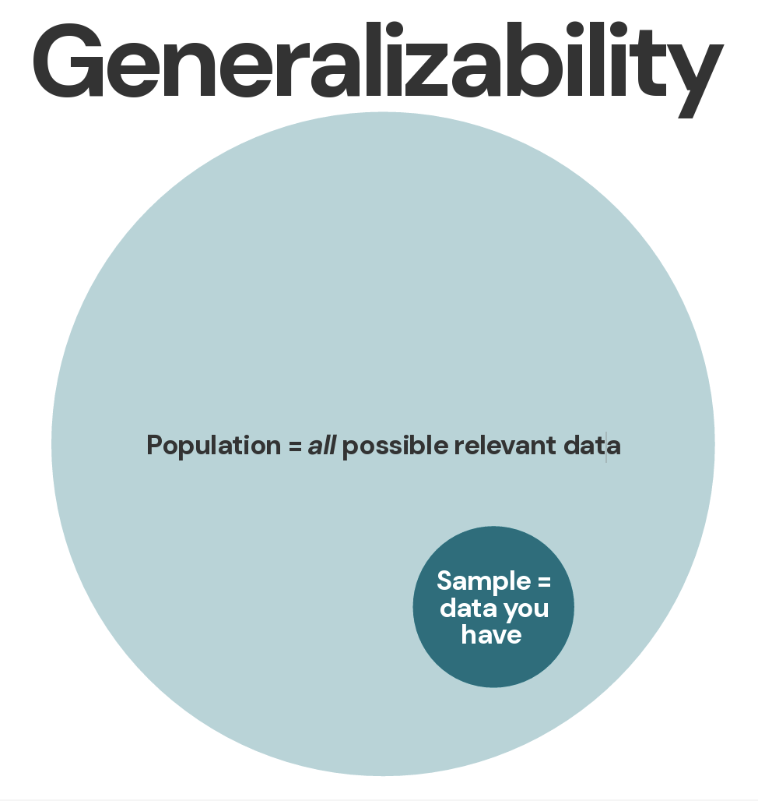{width=70% fig-align="center"}

:::

:::

---

### Think About It!

- Suppose we fit a regression model using predictors $X_1$, $X_2$, and $X_3$ all of which significantly explain an outcome $Y$.
- Another researcher fits a similar model on a *different sample* and obtains statistically significant coefficients.

::: {.fragment}

<span style="color:#1565C0;">*Does this necessarily mean **our fitted model** will predict well on that new sample?*</span>

**Not necessarily!** Statistical significance and predictive performance are two different questions.
:::

:::{.callout-note .fragment}

## Generalizability

We need to evaluate predictions made by our **original fitted model** on observations not used to estimate its coefficients.

:::

---

### Generalizability

::: {.columns .v-center}

::: {.column width="45%"}

- A model **generalizes** when it makes reasonably accurate predictions on **new, unseen observations** drawn from the population or setting of interest.
- Good fit on the data used to estimate a model is **not sufficient evidence** that the model will predict new data well.
- Our goal is not merely to explain the observations we have already seen, but to develop a model that can perform well on observations we **have not seen**.

:::

::: {.column width="55%"}

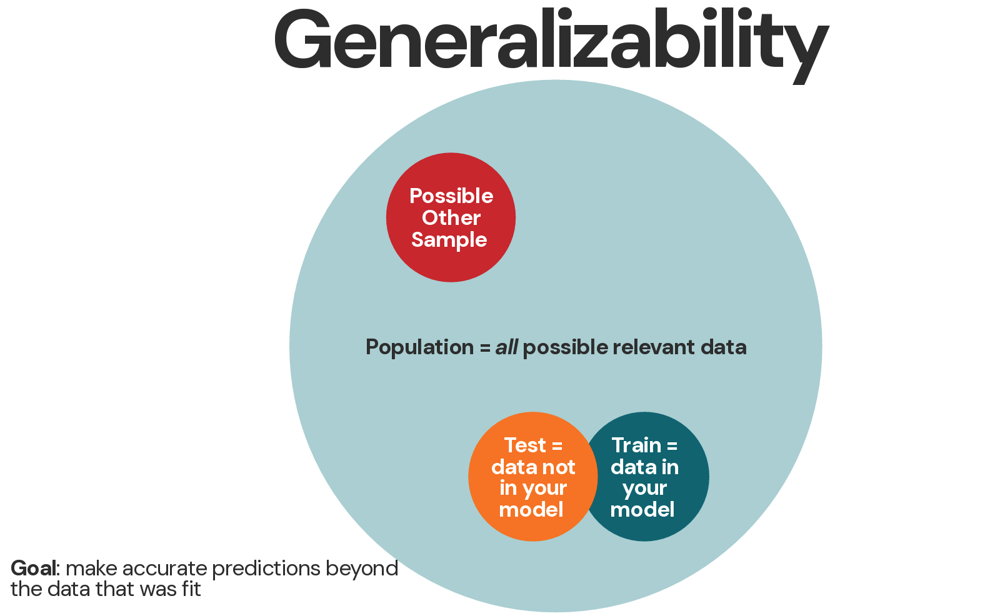{width=100% fig-align="center"}

:::

:::

:::{.callout-important}

## Two types of samples

Typically a learning process utilizes two types of samples.

- <span style="color:#1565C0;">**Training Sample**</span>: This is the data whose outcomes a model would try to mimic during the fitting process. The model sees both the feature set and the corresponding outcomes of observations present in this sample.
- <span style="color:#1565C0;">**Test Sample**</span>: It is expected for a model to fit the training data well as a consequence of the fitting process. But that itself, is not an indicator of the model generalizing the problem sufficiently well on the population. For this we require a separate sample that it has not been exposed to while training. This is key to obtaining a realistic view of the model's effectiveness.

:::

---

### Model Complexity and Generalizability

::: {.columns .v-center}

::: {.column width="45%"}

Models can range from **simple** (few predictors or a straight-line relationship) to **complex** (many predictors or flexible nonlinear relationships).

- A model that is too simple may miss important patterns in the data.
- A model that is too complex may fit random fluctuations in our sample rather than the underlying relationship.

We therefore need to consider how **model complexity** affects performance on unseen data.

:::

::: {.column width="55%"}

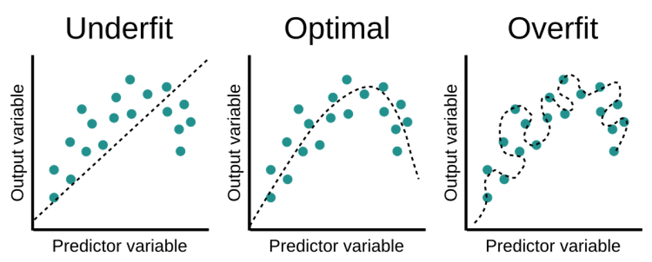{width=100% fig-align="center"}

:::

:::

---

### Training Error vs. Test Error

To characterize model fits we typically focus on two types of loss or error. We have looked at specific loss functions before and they vary depending on the problem but here we are talking from a general perspective.

::: {.columns .v-center}

::: {.column width="45%"}

- <span style="color:#1565C0;">**Training error**</span>: How poorly a model predicts observations used to fit it.
- <span style="color:#1565C0;">**Test error**</span>: How poorly the fitted model predicts observations **not used in fitting**. Typically, test error is measured on a finite, held-out sample of unseen data.

As model complexity increases, training error typically decreases. On the other hand, test error may initially decrease, but can rise when the model begins to overfit.

:::

::: {.column width="55%"}

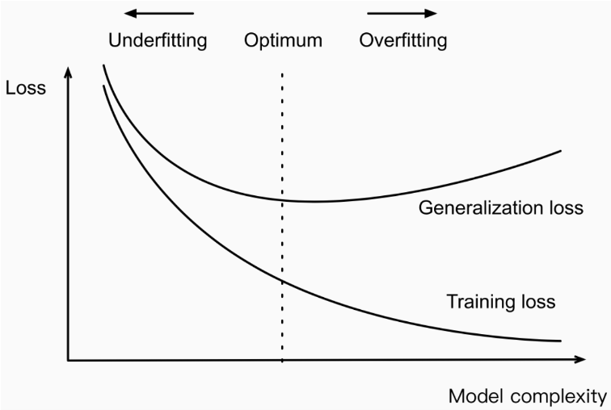{width=100% fig-align="center"}

:::

:::

:::{.callout-note}

## Generalization Error

What we truly care about when trying to understand how well a model fits a problem and its corresponding population data is the <span style="color:#1565C0;">**Generalization error**</span>. 
But generalization error is a theoretical value representing the expected error across all possible unseen data from the true underlying distribution.

Instead we use test error, which is the standard empirical estimate of a model's generalization error.

:::

---

### Underfitting vs. Overfitting

Generalization error is typically a consequence of two types of model fitting issues. 

::: {.columns}
::: {.column width="50%"}

:::{.callout-tip}

## Underfitting

- Model is too restrictive to capture meaningful relationships.
- Performs poorly even on the **training data**.
- These types of models are associated with <span style="color:#1565C0;">**high bias**</span>.
:::

:::

::: {.column width="50%"}

:::{.callout-tip}

## Overfitting

- Model fits peculiarities and noise in the **training data**.
- May achieve excellent training performance but poor **test performance**.
- Often associated with <span style="color:#1565C0;">**high variance**</span>.
:::

:::

:::

<span style="color:#1565C0;">*A good model balances this by learning meaningful patterns while avoiding unnecessary complexity that yields diminishing returns or worse*</span>.

---

### The Bias-Variance Tradeoff

As mentioned earlier, the fitting process is a tradeoff between:


- <span style="color:#1565C0;">*Learning*</span> the meaningful patterns in the data used to fit the model, *and*, 
- <span style="color:#1565C0;">*Not learning*</span> the training data *too well* to the point you memorize its patterns and its noise!

To understand the impact of each of these issues on your model, we need a better understanding of what constitutes learning error. Let's consider a regression model where error is calculated in the form of <span style="color:#1565C0;">*squared loss*</span>.

<span style="color:#1565C0;">**Error Decomposition Formula**</span>: The total expected prediction error (such as Mean Squared Error) can be broken down into three parts:
$$\text{Total Error} = Bias^2 + Variance + \text{Irreducible Noise}$$
$$\underbrace{E[(Y-\hat f(X))^2]}_{\text{Expected prediction error}} = \underbrace{\operatorname{Bias}[\hat f(X)]^2}_{\text{Systematic error}} + \underbrace{\operatorname{Var}[\hat f(X)]}_{\text{Sensitivity to sample}} + \underbrace{\sigma^2}_{\text{Irreducible error}}$$

- **Bias:** Error from a model that comes from systematically missing the underlying relationship.
- **Variance:** How much fitted predictions would change if we trained on a different sample?

<span style="color:#1565C0;">*A complex model often **reduces bias** at the expense of **increasing variance**.*</span>

---

### Visualizing the Bias-Variance Tradeoff

::: {.columns}

::: {.column width="50%"}

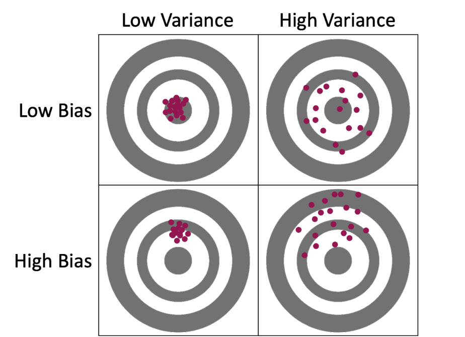{width=100% fig-align="center"}

:::

::: {.column width="50%"}

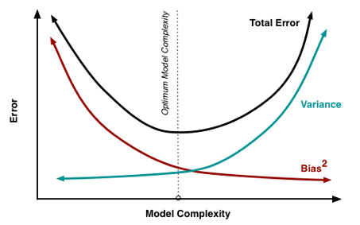{width=100% fig-align="center"}

:::

:::


::: {.callout-note}

## Two types of error.

The bias–variance tradeoff is the balance between two types of errors that stop machine learning models from performing well on new, unseen data.

- **High bias:** Predictions consistently miss the target. Symptom of an <span style="color:#1565C0;">*underfitted*</span> model.
- **High variance:** Predictions differ substantially across training samples. Symptom of an <span style="color:#1565C0;">*overfitted*</span> model.

The objective is to achieve **low error on unseen observations**, not necessarily the smallest training error. For regression, the model with the highest training $R^2$ or lowest training $RMSE$ is **not automatically the best model**. Instead, compare how well candidate models predict **held-out observations** and prefer the one with lower test error.
:::

---

### How Do We Evaluate Generalizability?

::: {.columns}

::: {.column width="50%"}

Two commonly used <span style="color:#1565C0;">*data splitting*</span> approaches help us estimate generalization error at the end of the model fitting process.

1. <span style="color:#1565C0;">**Train-test split**</span>: Randomize your dataset and reserve part of it for evaluating a model trained on the remainder.
    - Typically what we prefer is a <span style="color:#1565C0;">*train-validation-test*</span> split. More on this later!
2. <span style="color:#1565C0;">**Cross-validation**</span>: Repeatedly train and evaluate a model using different partitions of the available data.

:::

::: {.column width="50%"}

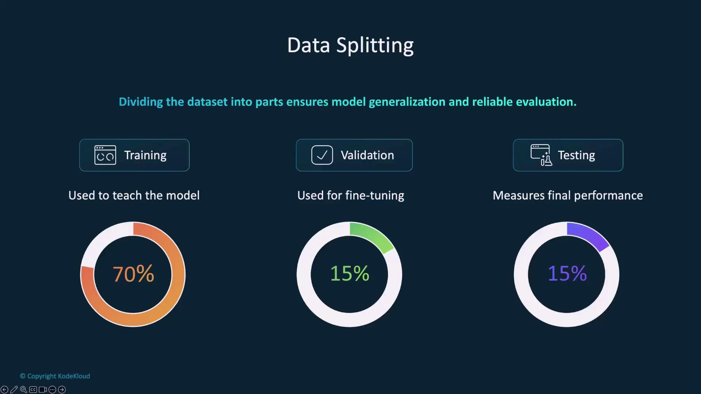{width=100% fig-align="center"}

:::

:::

Both attempt to approximate performance on **unseen data** without having to collect an entirely new sample.

---

### Train-Test Split

::: {.columns}

::: {.column width="50%"}

A common approach to partition data is to split your sample of observations into two **non-overlapping** sets.

- <span style="color:#1565C0;">**Training set**</span>: Used to estimate model coefficients.
- <span style="color:#1565C0;">**Test set**</span>: Used to evaluate predictions from the fitted model.

Common choices are **70/30** or **80/20** (training/testing), but there is no universally optimal ratio. Common splitting methods are <span style="color:#1565C0;">random</span> or <span style="color:#1565C0;">stratified</span> splitting.

:::

::: {.column width="50%"}

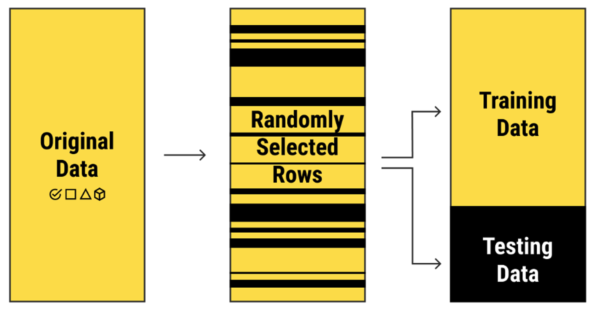{width=100% fig-align="center"}

:::

:::

For <span style="color:#1565C0;">classification</span>, we may use <span style="color:#1565C0;">**stratified splitting**</span> to preserve class proportions. This is particularly useful for datasets that show considerable class imbalance!

::: {.callout-note}

## Validation set

A <span style="color:#1565C0;">**validation set**</span> is different from a training set in that we do not use it to learn model parameters. Instead, it is used to inform meta-decisions, such as choosing between model designs or tuning experimental settings. 

For example, in iterative algorithms, the model coefficients are learned by minimizing a loss/error function on the training data. However, the choice of running the algorithm for *100 iterations* versus *200 iterations* is one of those meta-decisions. Here, the number of iterations is an experimental setting rather than a parameter directly learned by the model from the training data. These types of settings are called <span style="color:#1565C0;">**hyperparameters**</span>. To choose between these hyperparameter values, we can first train two versions of the model—one for $100$ iterations and the other for $200$—and then select the version that performs best on the validation set.

The <span style="color:#1565C0;">**final evaluation**</span> happens on the **test set** after all model parameters and hyperparameters have been chosen. We do not expose the model to the test set until then, which helps ensure an unbiased estimate of its generalization error.

:::

---

### Train-Test Split: A Simple Demonstration

We will use the built-in `mtcars` data (also available in Python through `statsmodels`) to predict fuel efficiency (`mpg`) from vehicle weight (`wt`) and horsepower (`hp`).

::: {.columns}
::: {.column width="50%"}

#### R

```{r}
set.seed(3100)
idx <- sample(seq_len(nrow(mtcars)),
              size = floor(0.7 * nrow(mtcars)))
train <- mtcars[idx, ]
test  <- mtcars[-idx, ]

fit <- lm(mpg ~ wt + hp, data = train)
pred <- predict(fit, newdata = test)
sqrt(mean((test$mpg - pred)^2))  # Test RMSE
```

:::
::: {.column width="50%"}

#### Python

```{python}
import statsmodels.api as sm
from sklearn.model_selection import train_test_split
from sklearn.linear_model import LinearRegression
from sklearn.metrics import mean_squared_error

df = sm.datasets.get_rdataset("mtcars").data
train, test = train_test_split(
    df, test_size=0.30, random_state=3100)
fit = LinearRegression().fit(train[["wt", "hp"]], train["mpg"])
pred = fit.predict(test[["wt", "hp"]])
print(mean_squared_error(test["mpg"], pred) ** 0.5)
```
:::
:::

::: {.callout-note}

## Splitting Methods

This example here is a demonstration of random splitting. However, stratified splitting could be the choice for classification problems with imbalanced class distribution in the data. A demonstration of this can be found in the <span style="color:#1565C0;">*Quiz 8 notebook*</span>.
:::

---

### Is One Split Enough?

A train-test split is **simple and computationally inexpensive** but we can think of a few downsides to this approach.

1. **High Variance in Performance**: Our estimate of test error depends on **which observations happened to be assigned to the test set**. A different random split may produce a different evaluation result. Depending on how the data get sliced, the test set can overestimate or underestimate model performance.
2. **Selection Bias and Distribution Mismatch**: If the split is not stratified or representative (or if grouped data is split improperly), the training and test sets can have skewed distributions that fail to reflect the actual population.
3. **Insufficient data**: What if we do not have enough observations in our original sample to extract a large enough representative test set and also leave enough examples for training?

<span style="color:#1565C0;">*Can we make better use of our available training observations when comparing models?*</span>

---

### Cross-Validation

To remedy the problems associated with a single split, we look into <span style="color:#1565C0;">**Cross-validation**</span>.

::: {.columns}
::: {.column width="55%"}

**Cross-validation** repeatedly partitions the data into subsets used for fitting and evaluating a model.

- Each observation can contribute to evaluating a model without being used to fit that particular iteration.
- We combine performance across iterations to obtain a more informative estimate than a single split.
- Cross-validation is especially useful for **comparing candidate models**.

:::

::: {.column width="45%"}

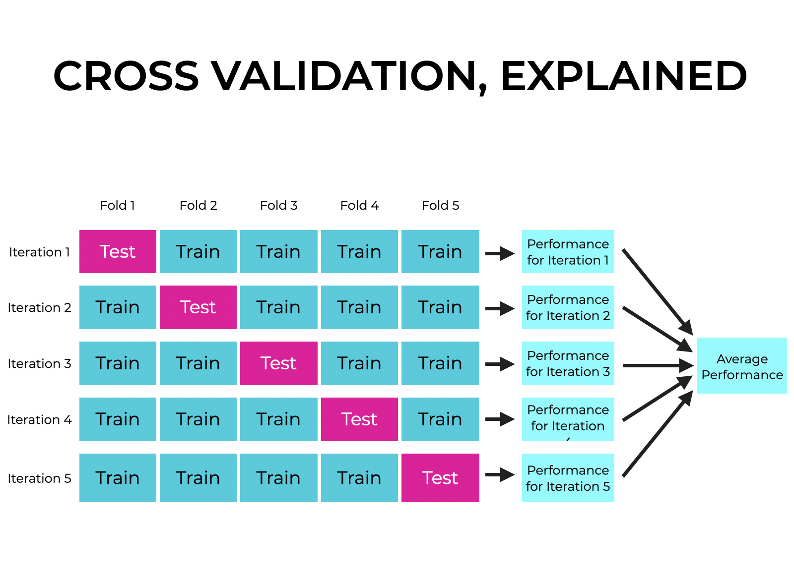{width=100% fig-align="center"}

:::

:::

---

### $k$-Fold Cross-Validation

::: {.columns}
::: {.column width="60%"}

1. Randomly divide the **training data** into $k$ approximately equal-sized folds.
2. Over $k$ iterations:

   - Select one of the $k$ folds as the **validation fold**.
   - Fit the model using the remaining $k-1$ folds.
   - Evaluate the model on the validation fold and record its validation error.
3. **Average the validation errors** across all $k$ iterations.
4. Use the average validation error to compare candidate models.

:::

::: {.column width="40%"}

{width=100% fig-align="center"}

:::

:::

Common choices include $k=5$ or $k=10$. 

::: {.callout-note}

### Reading Cross-Validation Results

Suppose we compare two candidate regression models using 5-fold cross-validation:

| Validation RMSE | Fold 1 | Fold 2 | Fold 3 | Fold 4 | Fold 5 | Mean |
|---|---:|---:|---:|---:|---:|---:|
| Model A | 3.2 | 3.5 | 3.1 | 3.7 | 3.5 | 3.4 |
| Model B | 3.0 | 4.5 | 2.8 | 4.2 | 3.5 | 3.6 |

- Model A has the **lower average RMSE** and is more consistent across these folds.
- We should consider both **average performance** and **variation across folds**.

:::

---

### Leave-One-Out Cross-Validation (LOOCV)

What if you are really in a pinch?

::: {.columns}

::: {.column width="60%"}

For extremely small datasets we might not have enough data for even a separate single fold that can act as a representative quasi-validation set! In such situations we use a special case of $k$-fold cross-validation where **$k=n$** called <span style="color:#1565C0;">LOOCV</span>

- For each iteration, fit the model on **$n-1$ observations** and predict the **one left-out observation**.
- Repeat for every observation, then combine the individual prediction errors into an overall performance metric.
- It makes extensive use of available data for training, but can be **computationally expensive** and its error estimate may have higher variability than $5$ or $10$-fold CV.

:::

::: {.column width="40%"}

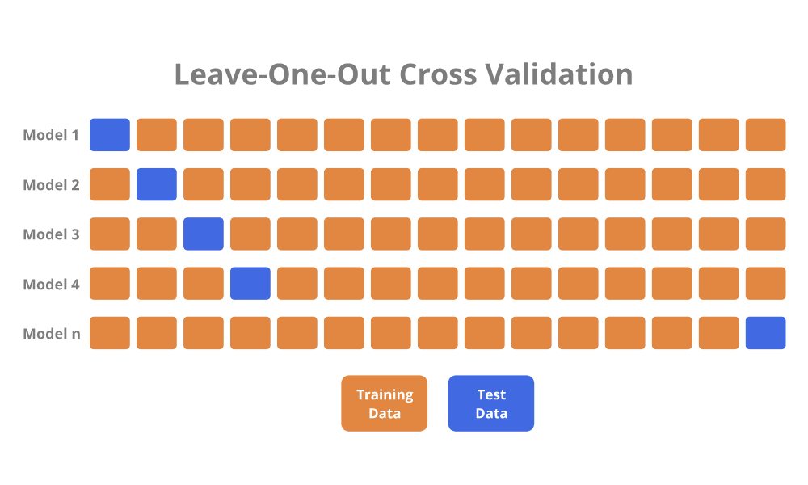{width=100% fig-align="center"}

:::

:::

::: {.callout-tip}

## Main tradeoffs

- Maximizes training data utilization.
- Zero randomness (deterministic results).
- Higher variance in estimates.
- No stratification.

:::

---

### Comparing the Approaches

| Construction | How evaluation works | Main consideration |
|---|---|---|
| Train-test split | Evaluate on one held-out test set | Depends on a single partition |
| $k$-fold CV | Average errors across $k$ validation folds | Repeated fitting; useful for model comparison |
| LOOCV | Leave one observation out each time | Many fits; often more computationally demanding |

::: {.callout-important}

## Rounding up the important distinctions

Use cross-validation on the **training data** to select a model. Keep a separate **test set** untouched for the final evaluation, when feasible.
:::

---

### Final Thoughts...

::: {.columns}

::: {.column width="60%"}

- **Generalizability** asks whether a model works beyond the sample used to fit it.
- **Train-test splitting** and **cross-validation** help us evaluate and select models using unseen observations.
  1. Separate a **test set** before comparing models.
  2. Use **training data** to fit candidate models.
    - **Cross-validation** is used when our datasets are not large enough for adequately sized training and validation sets.
  3. Evaluate it **once on the untouched test set** to estimate performance on new data.
- **Drawbacks**
  - Requires models to vary discretely in complexity.
  - Not all candidate models can be naturally ordered from simplest to most complex.

:::

::: {.column width="40%"}

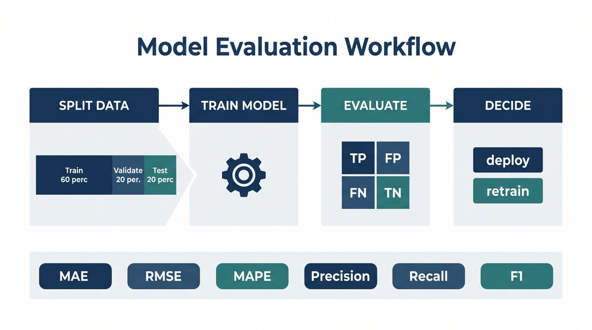{width=100% fig-align="center"}

:::

:::

::: {.callout-tip}

## Coming up next 

We have discussed how to *detect* problems with generalizability. 

Next, we will explore **regularization** as one approach to *controlling model complexity* and reducing overfitting. Rather than changing model dimension over a sequence of models, we start with a large model and add constraints on the size of coefficients to regulate or eliminate some parameters.

:::
